<div align="center">
  <picture>
    <source media="(prefers-color-scheme: dark)" srcset="brand/logo-dark.svg">
    
  </picture>

  <p><strong>Meeting notes that stay on your own server.</strong></p>

  <p>
    <a href="LICENSE"></a>
    <a href="https://github.com/dennisklappe/openminutes/releases/latest"></a>
    <a href="https://github.com/dennisklappe/openminutes/actions/workflows/ci.yml"></a>
  </p>

  <p>A bot joins your Google Meet and Microsoft Teams meetings, records the audio, notes who said what, and writes the transcript and an optional summary. Open source, self-hosted, no telemetry.</p>

  <p>
    <a href="https://openminut.es">Website</a> &nbsp;·&nbsp;
    <a href="docs/README.md">Docs</a> &nbsp;·&nbsp;
    <a href="docs/getting-started.md">Getting started</a> &nbsp;·&nbsp;
    <a href="https://github.com/dennisklappe/openminutes/releases">Releases</a>
  </p>
</div>

<p align="center">
<picture>
  <source media="(prefers-color-scheme: dark)" srcset="docs/images/readme/transcript-dark.webp">
  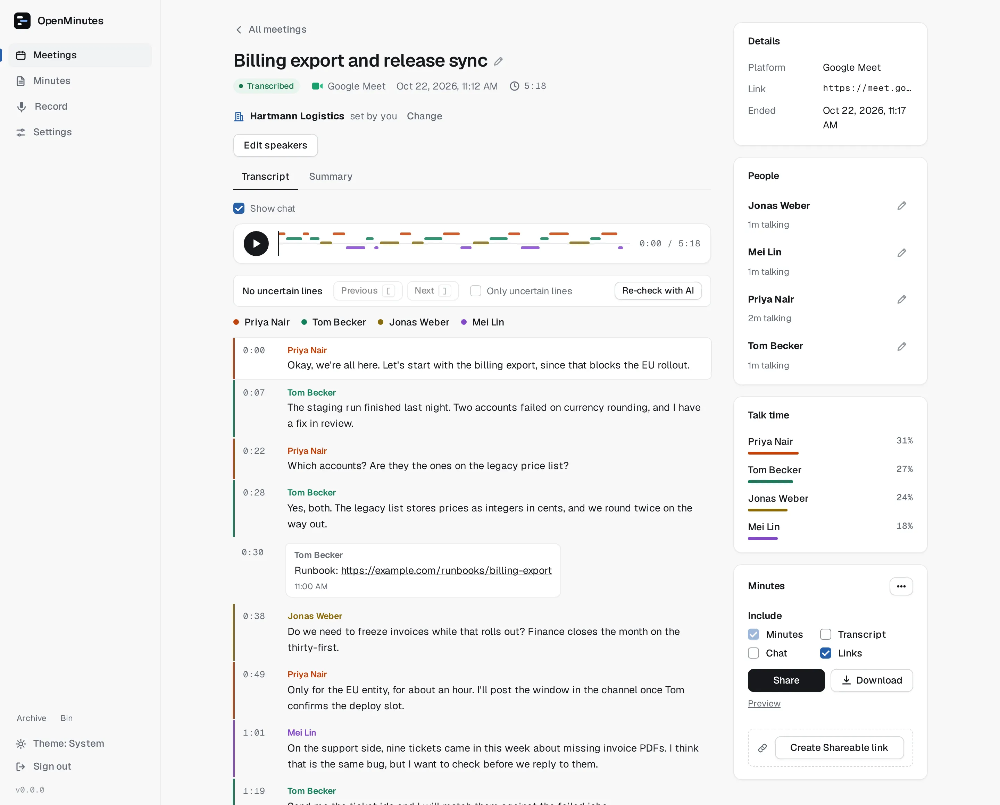
</picture>
</p>

---

## What it does

| Feature              | Details                                                                                  |
| -------------------- | ---------------------------------------------------------------------------------------- |
| Joins for you        | Reads Google Calendar and Outlook invites, or paste a Meet or Teams link to join now.    |
| Records audio        | Opus segments plus the participant list and active speaker, logged with timestamps.      |
| Knows who spoke      | Transcript words are aligned to who was speaking, so segments carry names.               |
| Transcribes anywhere | Local faster-whisper with no key, or OpenAI, Groq, Deepgram or AssemblyAI with yours.    |
| Summarises if asked  | Off by default. Any OpenAI-compatible endpoint (including Ollama) or Anthropic.          |
| Sorts your minutes   | A Minutes tab sorts transcripts by date, company or person, or in your own folders.      |
| Shares minutes       | Email the minutes to attendees through Emailit, SMTP or Gmail. Never without a click.    |
| Records in person    | A phone recorder (installable web app) for conversations that are not on a call.         |
| Stays yours          | One Postgres, one volume. Secrets encrypted at rest. No telemetry, no account, no cloud. |

## Install

You need a machine with Docker and about ten minutes.

```bash
curl -O https://raw.githubusercontent.com/dennisklappe/openminutes/main/compose.yaml
echo "OPENMINUTES_SECRET=$(openssl rand -hex 32)" > .env
docker compose pull
docker compose up -d
```

This pulls the published images. To build from source instead, see [CONTRIBUTING.md](CONTRIBUTING.md).

Then:

1. Open the web UI on port 3000 and set an admin password.
2. Follow the setup wizard: pick a transcription provider (local needs no key) and connect a calendar, or skip the calendar and paste links.
3. Paste a Meet or Teams link under Meetings and press Join meeting. The bot appears in the participant list.
4. Admit the bot if the meeting has a lobby. When the meeting ends, the transcript shows up within minutes.
5. Open the meeting, name the speakers if needed, then Share the minutes or download them.

`OPENMINUTES_SECRET` is the only value you must set yourself: it encrypts stored secrets, so back up `.env`. Other options are in [.env.example](.env.example). Add `--profile local` to run the bundled faster-whisper transcriber.

Guides: [getting started](docs/getting-started.md), [HTTPS](docs/reverse-proxy.md), [Google](docs/google-oauth.md), [Azure](docs/azure-app.md), [providers and cost](docs/providers.md). Updating: [UPGRADING.md](UPGRADING.md).

## How it works

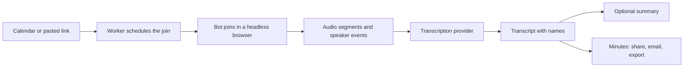

- **web** serves the UI and API, **worker** watches calendars and runs jobs, **bot** joins and records. All land in one Postgres and one data volume.
- Speaker names come from the meeting page (who is highlighted as speaking), not from guessing voices. Phone recordings use voice separation, see [speakers](docs/speakers.md).

## Supported platforms and providers

| Area          | Supported                                                                            |
| ------------- | ------------------------------------------------------------------------------------ |
| Meetings      | Google Meet, Microsoft Teams, phone recorder                                         |
| Calendars     | Google Calendar, Outlook (Microsoft 365)                                             |
| Transcription | Local faster-whisper, OpenAI, Groq, Deepgram, AssemblyAI                             |
| Summaries     | None (default), any OpenAI-compatible endpoint (OpenAI, Ollama, DeepSeek), Anthropic |
| Email         | Emailit, SMTP, Gmail                                                                 |
| Storage       | Local volume or any S3-compatible bucket                                             |
| Not in v1     | Zoom, Webex, live captions                                                           |

## Screenshots

<table>
<tr>
<td width="50%" valign="top">
<picture>
  <source media="(prefers-color-scheme: dark)" srcset="docs/images/readme/meetings-dark.webp">
  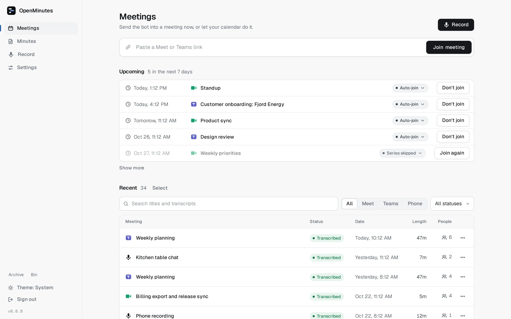
</picture>
<sub><b>Meetings: join now or let the calendar do it</b></sub>
</td>
<td width="50%" valign="top">
<picture>
  <source media="(prefers-color-scheme: dark)" srcset="docs/images/readme/summary-dark.webp">
  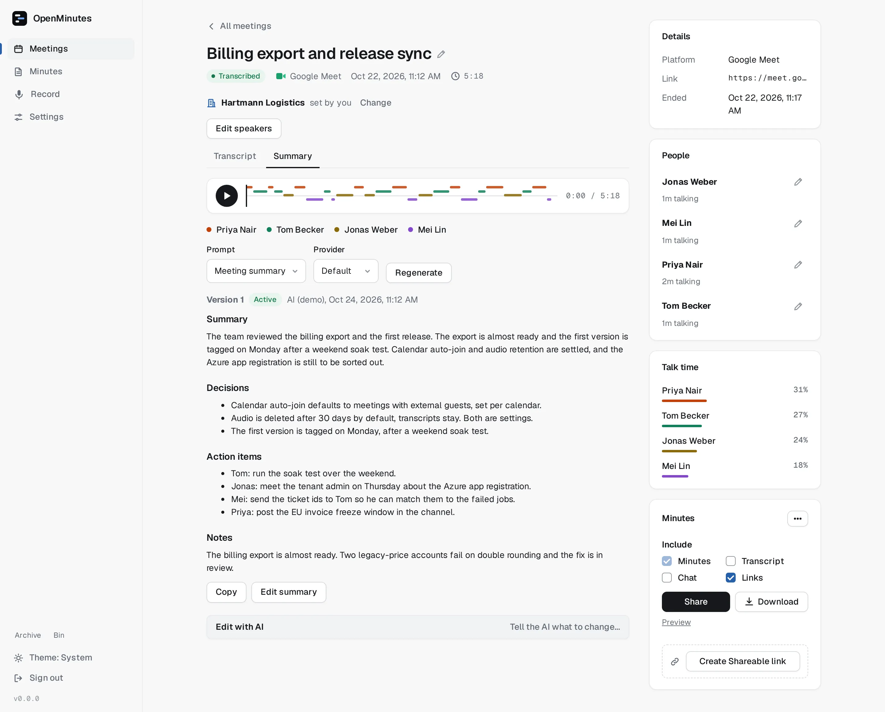
</picture>
<sub><b>Summary: decisions and action items</b></sub>
</td>
</tr>
<tr>
<td width="50%" valign="top">
<picture>
  <source media="(prefers-color-scheme: dark)" srcset="docs/images/readme/library-dark.webp">
  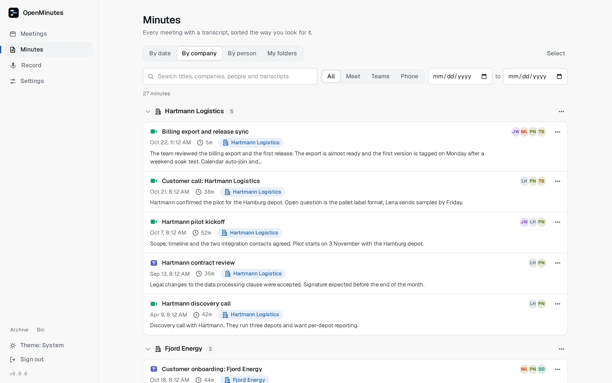
</picture>
<sub><b>Minutes library: by date, company, person or folder</b></sub>
</td>
<td width="50%" valign="top">
<picture>
  <source media="(prefers-color-scheme: dark)" srcset="docs/images/readme/share-dark.webp">
  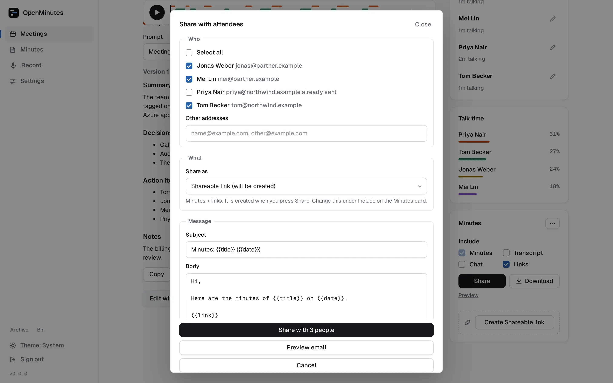
</picture>
<sub><b>Share with attendees, never without a click</b></sub>
</td>
</tr>
<tr>
<td width="50%" valign="top">
<picture>
  <source media="(prefers-color-scheme: dark)" srcset="docs/images/readme/settings-bot-dark.webp">
  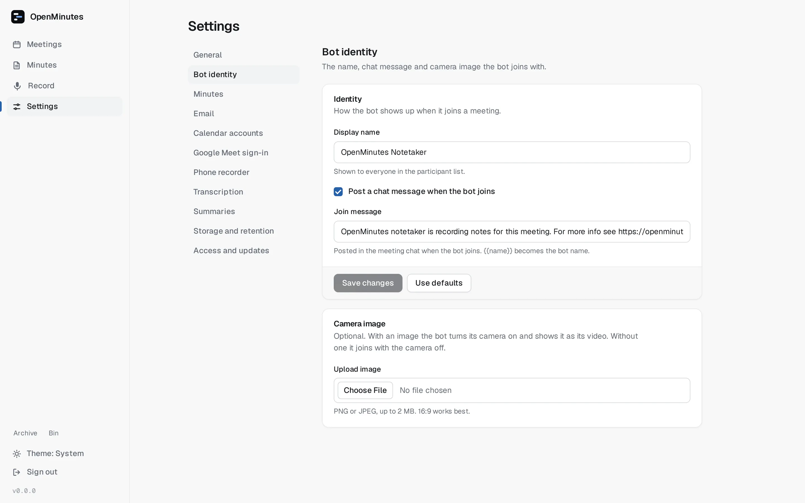
</picture>
<sub><b>Bot identity: name, chat message, camera image</b></sub>
</td>
<td width="50%" valign="top">
<picture>
  <source media="(prefers-color-scheme: dark)" srcset="docs/images/readme/settings-transcription-dark.webp">
  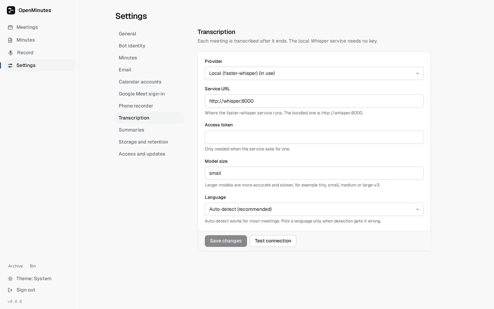
</picture>
<sub><b>Transcription: local or your own provider key</b></sub>
</td>
</tr>
</table>

On your phone:

<table>
<tr>
<td width="25%" valign="top" align="center">
<picture>
  <source media="(prefers-color-scheme: dark)" srcset="docs/images/readme/mobile-meetings-dark.webp">
  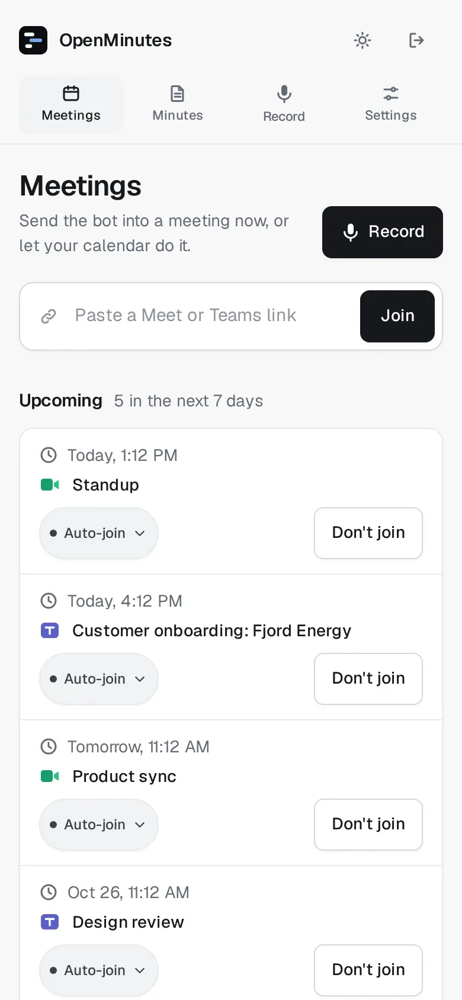
</picture>
<sub><b>Meetings</b></sub>
</td>
<td width="25%" valign="top" align="center">
<picture>
  <source media="(prefers-color-scheme: dark)" srcset="docs/images/readme/mobile-transcript-dark.webp">
  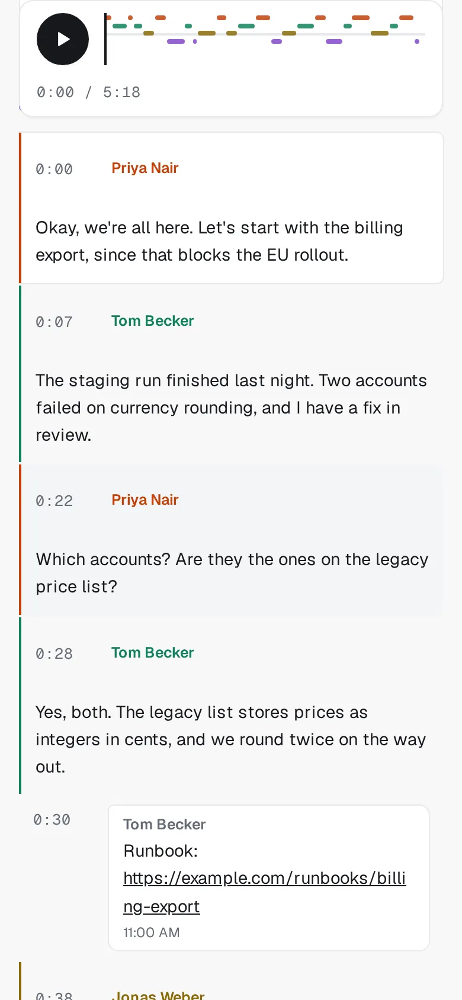
</picture>
<sub><b>Transcript</b></sub>
</td>
<td width="25%" valign="top" align="center">
<picture>
  <source media="(prefers-color-scheme: dark)" srcset="docs/images/readme/mobile-who-is-who-dark.webp">
  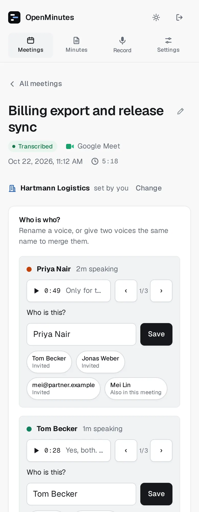
</picture>
<sub><b>Who is who</b></sub>
</td>
<td width="25%" valign="top" align="center">
<picture>
  <source media="(prefers-color-scheme: dark)" srcset="docs/images/readme/mobile-recorder-dark.webp">
  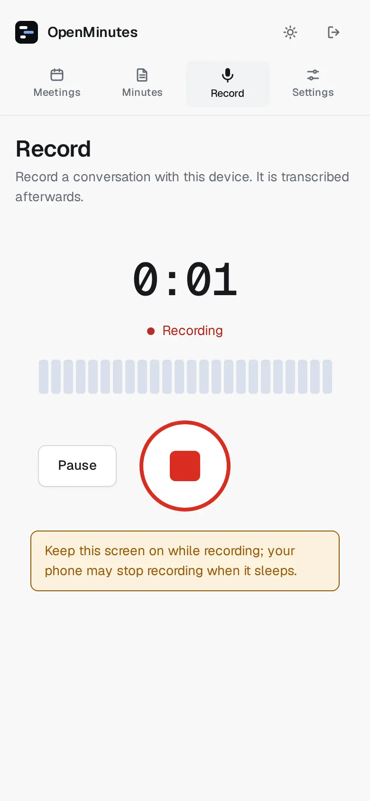
</picture>
<sub><b>Phone recorder</b></sub>
</td>
</tr>
</table>

## Status and limits

OpenMinutes is early: v0.1.0 is the first release. Expect breaking changes before v1. Progress is on the [roadmap](docs/roadmap.md).

- **Google Meet** refuses signed-out guests from automated browsers. For reliable joins, sign the bot in with a dedicated Google account, see [Meet sign-in](docs/meet-sign-in.md).
- **Microsoft Teams** works as a guest, unless the tenant blocks anonymous guests, see [Teams](docs/teams.md).
- Meetings that block guests, Zoom and Webex are not supported yet.
- Speaker detection depends on the meeting page and has known limits, see [speakers](docs/speakers.md).

## Privacy

- No telemetry, no account, no phone home. The only outbound traffic is to the calendar, mail and AI providers you configure.
- With the local transcriber and no summary provider, audio and text never leave your server.
- Secrets are encrypted at rest with `OPENMINUTES_SECRET`.
- The bot always announces itself by name. You are responsible for following the recording and consent laws that apply to your meetings, see [consent and legal notes](docs/consent-and-legal.md).

## Hosted option

Would rather not run it yourself? [openminut.es](https://openminut.es) is the hosted version.

## Documentation

Everything is in [docs](docs/README.md).

## Contributing

Contributions are welcome, see [CONTRIBUTING.md](CONTRIBUTING.md).

## Licence

[AGPL-3.0](LICENSE).
