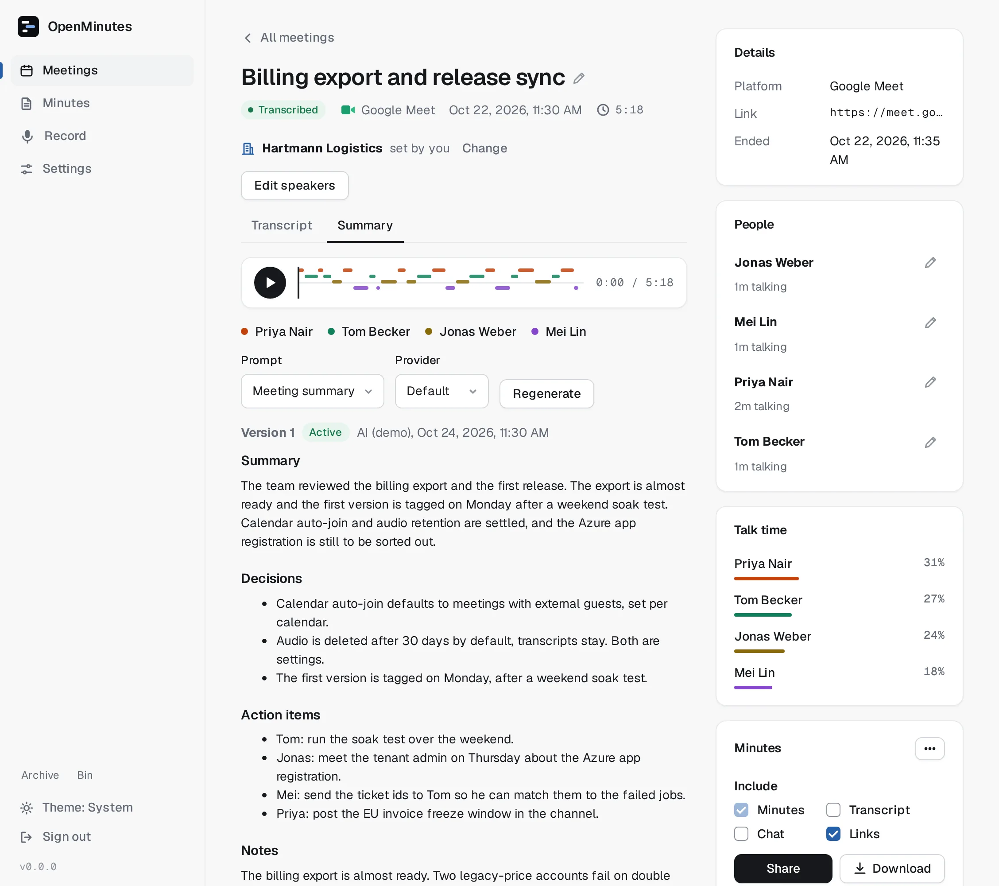
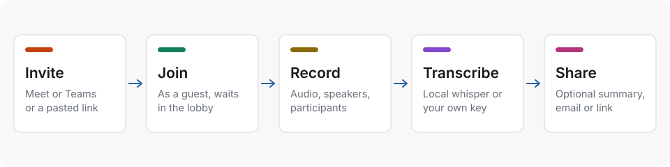

# OpenMinutes

## What OpenMinutes is

Open source, self-hosted notetaker. A bot joins your Google Meet and Microsoft Teams meetings, records audio, notes who said what, and writes the transcript and an optional summary. Docker Compose, your own provider keys or a local transcriber, no telemetry.

> [!NOTE]
> Early release (v0.1): expect breaking changes. The [roadmap](roadmap.md) lists what works today.

<picture>
  <source media="(prefers-color-scheme: dark)" srcset="images/meeting-dark.webp">
  
</picture>

## What you get

| Feature         | Details                                                                    |
| --------------- | -------------------------------------------------------------------------- |
| Joins for you   | Reads Google Calendar and Outlook invites, or paste a Meet or Teams link.  |
| Knows who spoke | Transcript words are aligned to who was speaking, so segments carry names. |
| Transcribes     | Local faster-whisper (no key), or OpenAI, Groq, Deepgram, AssemblyAI.      |
| Summarises      | Off by default. OpenAI-compatible endpoints (incl. Ollama) or Anthropic.   |
| Shares minutes  | Email attendees or share a link. Never without a click.                    |
| Stays yours     | One Postgres, one volume. Secrets encrypted at rest.                       |

## How it works

<picture>
  <source media="(prefers-color-scheme: dark)" srcset="images/how-it-works-dark.svg">
  
</picture>

Calendar sync (or a pasted link) starts the bot a minute before the meeting. After it, the audio is transcribed and an optional summary is written.

## Requirements

- Docker with the Compose plugin, about 1 vCPU and 1.5 GB of RAM per simultaneous meeting. See [sizing](sizing.md).
- For calendar sign-in: a hostname you control, ideally behind HTTPS. See [reverse proxy and HTTPS](reverse-proxy.md).
- Optional: your own Google OAuth client and Azure app registration for calendar auto-join.
- Optional: a transcription or summary provider key. Local transcription needs none.

**New here?** Read the [FAQ](faq.md), then [Install](getting-started.md). Then [reverse proxy](reverse-proxy.md), a [calendar](google-oauth.md) and [providers](providers.md).

## All guides

### Start

- [Install](getting-started.md): Run OpenMinutes with Docker Compose, finish the setup wizard and record your first meeting.
- [Updating](upgrading.md): Update with two commands, pin a version, roll back, and back up first.

### Set up

- [Google calendar](google-oauth.md): Create a Google Cloud OAuth client so OpenMinutes can read your Google Calendar.
- [Microsoft calendar](azure-app.md): Create a Microsoft Entra app registration so OpenMinutes can read your Outlook calendar.
- [Meet bot account](meet-sign-in.md): Let the bot join Google Meet with a dedicated Google account.
- [Microsoft Teams](teams.md): Which Teams links work, what the bot does on the way in, and why a tenant can stop it.
- [Transcription and summaries](providers.md): Which providers OpenMinutes supports, what each needs and what it costs.
- [Email and sharing](email.md): Email providers, the Share with attendees dialog and how to add another provider.
- [Reverse proxy and HTTPS](reverse-proxy.md): Put OpenMinutes behind Caddy, a Cloudflare Tunnel or Cloudflare Access.
- [Bot identity](bot-identity.md): The name, join chat message and camera image the bot joins with.
- [Meetings in several calendars](duplicate-meetings.md): One bot per meeting when the same invite arrives through several connected calendars, how copies are matched and joined.

### Use

- [Minutes library](minutes-library.md): Browse minutes by date, company or person, and keep them in folders.
- [Minutes and sharing](minutes.md): Choose a template, add your logo, share minutes with a link and export them to the formats you need.
- [Summary versions and AI edit](summaries.md): Every summary is a version: edit by hand, rewrite with AI, restore, regenerate.
- [Speakers and accuracy](speakers.md): Where speaker names come from, how they are matched to the transcript, and the known limits.
- [Participant names](participants.md): Rename people, how the summary follows, remembered names and absent invitees.
- [Voices and speaker names](voices.md): Name voices, manage people and the optional voice profiles.
- [Meeting chat](chat.md): How the bot captures the Meet and Teams chat and where it ends up.
- [Phone recorder](phone-recorder.md): Record in person on your phone, also offline, with a speaker count and crash recovery.
- [Import from Fireflies](import-fireflies.md): Bring your Fireflies meetings in recordings from your account data export, transcribed and summarised by your own setup.
- [Archive and bin](archive-and-bin.md): Archive minutes, delete with 30 days to restore, the daily purge.

### Operate

- [Configuration](configuration.md): The one variable you must set, and the settings you change in the app.
- [Storage and retention](storage.md): Keep recordings on a local volume or an S3-compatible bucket, and delete audio after a number of days.
- [Sizing](sizing.md): How much CPU, memory and disk to plan for, and how many meetings a single server can record at once.
- [Skipped and stuck meetings](meeting-lifecycle.md): Skip a meeting or series, lobby timeout, the watchdog and making room for a new link.
- [Troubleshooting](troubleshooting.md): Common problems with joining, speakers, calendars and providers, and what to do.

### Reference

- [Consent and privacy](consent-and-legal.md): What to think about before a bot records your meetings. General information, not legal advice.
- [API](api.md): Create an API key and let other services read transcripts and summaries and change meetings, people and settings.
- [API endpoint reference](api-reference.md): Every API method and path, generated from the routes, with the key access each one needs.
- [Phone recorder API](phone-recorder-api.md): The upload endpoints behind the phone recorder: what the phone sends and what the server answers.
- [Architecture](design.md): How the pieces of OpenMinutes fit together, what version 1 covers and leaves out, and why it was built this way.
- [Roadmap and status](roadmap.md): Where OpenMinutes stands today and what comes next.
- [FAQ](faq.md): Short answers to the questions people ask first about OpenMinutes: supported platforms, privacy, consent, cost and hosting.

Reference screenshots (light and dark, from fictional demo data via `node e2e/ui/readme-shots.mjs`) live in `docs/images/readme`.
