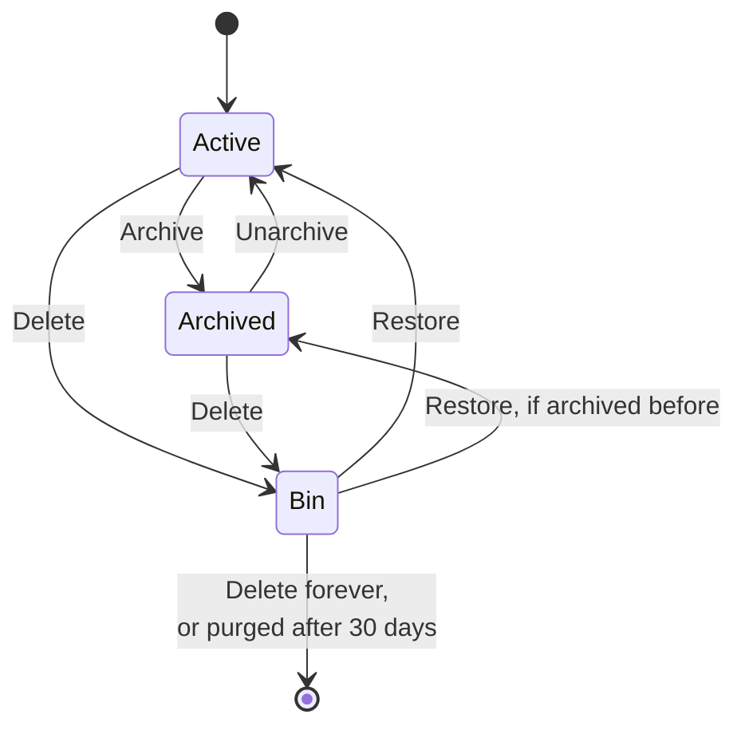

# Archive and bin

Meetings that are over can be archived or deleted from the three dots menu or More on the meeting page. Select does several at once. Running or upcoming meetings offer neither: use the Auto-join pill and choose Don't join this meeting.

Archive and Bin links sit at the bottom of the sidebar (Bin shows a count), and at the bottom of the Minutes page on a phone.

## Archive

Archive keeps a meeting for good and out of your way. It disappears from Meetings, Minutes and their search, and is listed under Archive, with Unarchive and Delete.

- Nothing is removed: audio, transcript, summary versions, exports and share links stay, and share links keep working.
- The meeting page opens as usual and shows it is archived.

> [!NOTE]
> Archiving does not pause audio retention. With Delete audio after a number of days on (see [Storage and retention](storage.md)), archived audio is still deleted on schedule. Transcript and summaries stay. Leave retention off to keep everything.

## Delete and the bin

Delete asks first, then moves the meeting to the Bin for 30 days, showing the days left. There it can be restored or deleted forever right away.

- **Share links stop working at once**, also after a restore. Create a new link.
- **Calendar events** that contain the share link keep it, but it opens a not found page.
- A binned meeting is hidden everywhere and cannot be opened.
- Restoring a meeting that was archived before it was deleted puts it back in the archive.

Daily, the worker purges meetings that spent 30 days in the bin: audio (including the untrimmed original, locally and in S3), transcript, summaries, speakers, chat and exports. Documents already exported to Google Docs, Word or OneDrive stay. This cannot be undone.

A calendar sync never schedules an archived or binned meeting again.

## API

Routes need a session and live under `/api`.

| Route                            | What it does                                                                     |
| -------------------------------- | -------------------------------------------------------------------------------- |
| `GET /meetings?scope=archived`   | The archive. `scope=bin` lists the bin with `deletedAt` and `purgeAt`            |
| `POST /meetings/:id/archive`     | Archive. `409` when running, upcoming or already archived                        |
| `POST /meetings/:id/unarchive`   | Unarchive                                                                        |
| `DELETE /meetings/:id`           | Move to the bin, revoke share links. `409` while running or upcoming             |
| `POST /meetings/:id/restore`     | Restore from the bin                                                             |
| `DELETE /meetings/:id?forever=1` | Delete a binned meeting for good                                                 |
| `POST /meetings/bulk`            | `{action, ids}`: `archive`, `unarchive`, `delete`, `restore`, `purge`, up to 200 |
