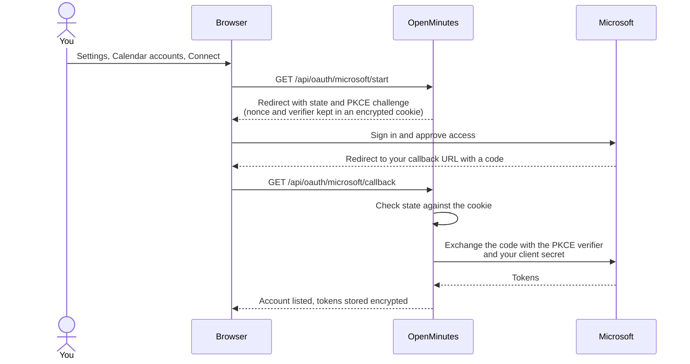

# Create an Azure app registration

Time: about 10 minutes. Needed for: Outlook and Microsoft 365 calendar auto-join, Word on OneDrive export.

You register your own app in Microsoft Entra: no shared app is shipped. You need an account that can create app registrations (a work tenant may need an administrator). A personal account works.

## 1. Register the app

1. Open the [Microsoft Entra admin center](https://entra.microsoft.com/), Identity, Applications, App registrations.
2. New registration, name `OpenMinutes`.
3. Supported account types: Single tenant only (your organisation), or Any Entra ID Tenant + Personal Microsoft accounts. Personal calendars (Outlook.com, Hotmail, Live) need the second.
4. Redirect URI: Web, `<your OpenMinutes URL>/api/oauth/microsoft/callback`, for example `https://openminutes.example.com/api/oauth/microsoft/callback`. Settings, Calendar accounts shows the exact URI with a Copy button. It must match character for character.
5. Register.

## 2. Add API permissions

1. API permissions, Add a permission, Microsoft Graph, Delegated permissions.
2. Add the permissions below.
3. If your tenant requires it, press Grant admin consent. Otherwise the first sign-in shows a consent screen (marked unverified, you are the publisher): accept it.

| Permission                                                         | Add it for                                                                                        |
| ------------------------------------------------------------------ | ------------------------------------------------------------------------------------------------- |
| `Calendars.Read`, `offline_access`, `User.Read`, `openid`, `email` | Calendar sync (read only).                                                                        |
| `Files.ReadWrite`                                                  | Word on OneDrive export. Requested only when you connect with export access in Settings, Minutes. |
| `Calendars.ReadWrite`                                              | Optional, minutes link in the calendar (below).                                                   |

Optional: minutes link in the calendar

For Settings, Minutes, Export, Add the minutes link to the calendar event, add the delegated permission `Calendars.ReadWrite`. It is requested only on Allow calendar links in Settings, Minutes, Export. Other accounts stay read-only, and the meeting page says so.

- Only the event body is PATCHed.
- Graph cannot suppress notifications (unlike Google's `sendUpdates=none`), so Outlook may send guests an updated-event notice.
- If you are only a guest, Graph answers 403 and the meeting page says "Could not add link to calendar (no permission)".
- Microsoft returns only the permissions requested in one sign-in: if the account also exports to OneDrive, connect with export access again after allowing calendar links.

## 3. Create a client secret

1. Certificates and secrets, New client secret.
2. Pick an expiry (maximum 24 months). Note the date: sync stops when it expires, until you paste a new secret into OpenMinutes.
3. Copy the secret Value at once with its copy button (shown once, the table truncates it). Not the Secret ID.

## 4. Collect the IDs

On the Overview page, copy the Application (client) ID and the Directory (tenant) ID.

## 5. Give it to OpenMinutes

1. Settings, Calendar accounts, Microsoft panel: paste client ID and secret.
2. Tenant: the tenant ID for organisation only, or `common` for any organisation plus personal accounts. With `common`, choose Use another account to type a personal address.
3. Save changes, Connect Microsoft, sign in.

New calendars start on Never: pick a rule per calendar (all meetings, only meetings you organise, only meetings with external guests, or never).

## How connecting works

## How sync works

- Polls every 2 minutes, next 14 days, no webhooks, so your server need not be reachable from Microsoft. Rescheduled and deleted events update or cancel the queued join.
- Sync now in Settings, Calendar accounts syncs immediately. Disconnecting cancels queued joins.
- To revoke access fully, remove the app under the Enterprise application entry or delete the registration.

## If it fails

| Error                    | Fix                                                                                                                                                       |
| ------------------------ | --------------------------------------------------------------------------------------------------------------------------------------------------------- |
| `AADSTS50011`            | Redirect URI mismatch. Copy it again from Settings, Calendar accounts. Behind a proxy set `OPENMINUTES_PUBLIC_URL`, see [reverse proxy](reverse-proxy.md) |
| `AADSTS7000215`          | You pasted the Secret ID instead of the Value, or the secret expired. Create a new one                                                                    |
| `AADSTS700016`           | Wrong tenant ID, or the app only allows another tenant. Check Supported account types                                                                     |
| `AADSTS65001`            | Press Grant admin consent under API permissions, or ask your administrator                                                                                |
| Personal account missing | Set the tenant to `common` and choose Use another account                                                                                                 |

Joining Teams meetings as a guest is separate from this app, see [Teams](teams.md).
