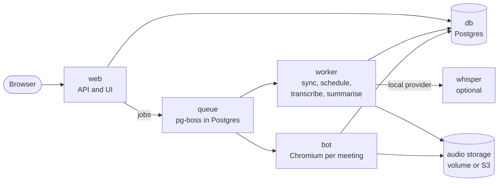
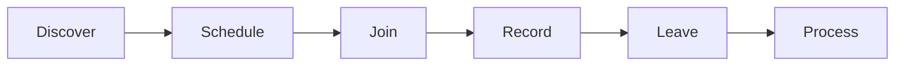

# OpenMinutes: design

Status and next steps: [roadmap](roadmap.md).

## Goals

- `docker compose up` and a setup wizard. No `.env` editing beyond one secret.
- Auto-join from Google Calendar and Outlook invites, or paste a link to join now.
- Store audio plus metadata: meeting name, start and end time, participants, per-speaker segments with timestamps.
- Pluggable transcription and summaries. Zero keys needed (local transcription, no summary).
- Single-user first.

## Non-goals (v1)

- Zoom, Webex.
- Live captions in the UI.
- Joining meetings that block anonymous or bot guests (reported clearly instead).
- Hosted SaaS.

## Architecture

Containers:

| Container            | Role                                                                                                                    |
| -------------------- | ----------------------------------------------------------------------------------------------------------------------- |
| `web`                | API and UI (TypeScript, Hono, React): wizard, settings, meeting list and detail pages.                                  |
| `worker`             | Job runner: calendar sync, scheduling, transcription, summary. No browser.                                              |
| `bot`                | Chromium + Playwright + Xvfb + PulseAudio. One browser context per meeting. Controlled by the worker through the queue. |
| `db`                 | Postgres only. A SQLite "lite" mode was dropped: pg-boss and the migrations assume Postgres.                            |
| `whisper` (optional) | faster-whisper service, only in the `local` image variant.                                                              |

Queue: pg-boss in Postgres, no Redis. Storage: local volume, S3-compatible optional. Images: `slim` (cloud providers only) and `local` (bundles faster-whisper).

## Meeting lifecycle

1. **Discover**: the calendar is polled every 2 minutes (next 14 days) for Meet or Teams links, see [Google](google-oauth.md#how-sync-works). Or paste a link in the UI.
2. **Schedule**: a `join` job is created for the start time minus 1 minute. Per-calendar rules: all, only meetings I organise, only with external guests, or never.
3. **Join**: the bot opens the link as a guest named "OpenMinutes" (configurable), mutes mic and camera and waits in the lobby (default timeout 10 minutes). Meet can use a signed-in Google account, see [Signing the Meet bot in](meet-sign-in.md).
4. **Record**: browser audio via a virtual PulseAudio sink, written as Opus segments. Participants and active speaker are read from the page about 4 times a second.
5. **Leave**: the bot is alone, the meeting ends, the host removes it, or the maximum duration is hit.
6. **Process**: merge audio, transcribe, align speakers, store. A summary runs if configured.

All statuses and what can go wrong: [Meeting lifecycle](meeting-lifecycle.md).

## Speakers

The page's active-speaker events decide who spoke, with provider or local diarization as the fallback. See [speakers](speakers.md).

## Data model

Tables

- `meetings`: id, title, platform, join_url, join_key, scheduled_start, started_at, ended_at, status, error.
- `meeting_sources`: meeting_id, calendar_id, calendar_event_id, joinable. One row per calendar copy; a meeting is unique on (join_key, scheduled_start).
- `participants`: id, meeting_id, display_name, email (nullable), joined_at, left_at.
- `audio_files`: id, meeting_id, path, duration, codec, size.
- `speaker_events`: meeting_id, participant_id, start_ms, end_ms.
- `transcript_segments`: meeting_id, participant_id (nullable), start_ms, end_ms, text, confidence.
- `summaries`: id, meeting_id, provider, model, prompt_id, status (pending, done, failed), error, content, created_at (several per meeting).
- `calendar_accounts`: provider, account email, encrypted tokens, sync state.
- `settings`: key/value, secrets encrypted with `OPENMINUTES_SECRET`.

## Providers

A provider is one file implementing `transcribe(audio) -> segments` and `summarize(transcript, prompt) -> text`. Which exist: [providers](providers.md).

## Security and privacy

- Secrets and OAuth tokens encrypted at rest with `OPENMINUTES_SECRET`.
- Single admin password at first run; OIDC later.
- The bot always announces itself by name, with an optional chat message on join ("Recording for notes"). Users are responsible for consent laws.
- No telemetry.

## Known risks

- Teams: the tenant must allow anonymous join, and some orgs block it. The reason is shown in the meeting status.
- Meet: the host must admit the bot. Google may add bot detection, so keep the browser profile realistic.
- DOM scraping breaks on UI changes (mitigated by fixtures and small per-platform modules).
- Each concurrent meeting costs about 1 vCPU and 1.5 GB RAM, hence the concurrency cap. See [Sizing](sizing.md).
- Users need their own Google OAuth client and Azure app registration.

## Tech choices

TypeScript, pnpm monorepo (`apps/web`, `apps/worker`, `apps/bot`, `packages/providers`, `packages/platforms`). Hono, Drizzle (Postgres), pg-boss, React + Vite, Playwright. License: AGPL-3.0 (keeps hosted forks open).
