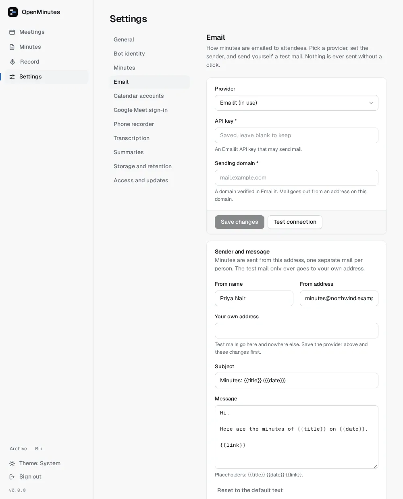
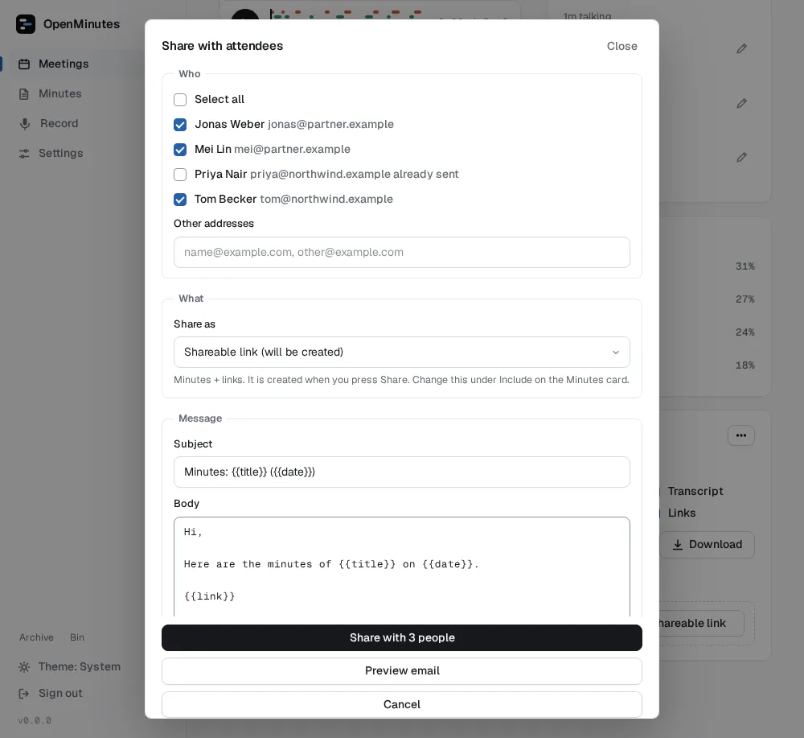
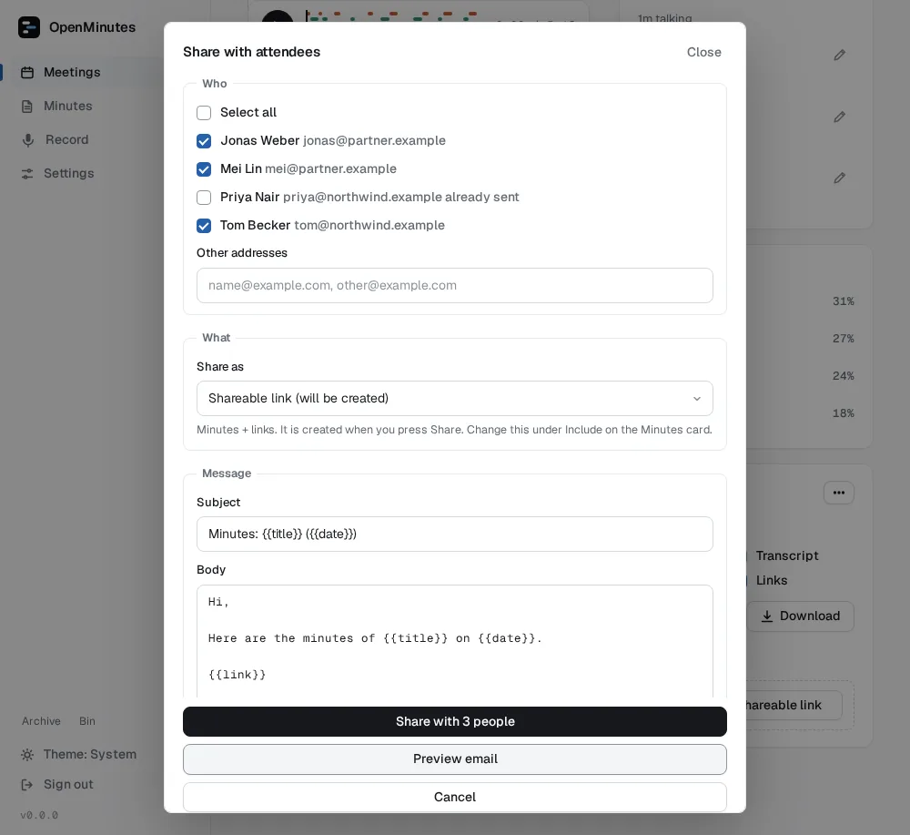

# Sharing minutes by email

Share with attendees emails the minutes to the people on the invite. Nothing is sent by itself: every mail starts with your click, and the dialog says how many people it reaches. Setup takes 5 to 10 minutes.

## Set it up

Settings, Email:

1. Pick a provider (SMTP is the default) and save. Credentials are stored encrypted like other provider keys.
2. Set the from name, from address and your own address.
3. Send a test mail. It only ever goes to your own address.
4. Optionally edit subject and message. Placeholders: `{{title}}`, `{{date}}`, `{{link}}` (link to the minutes, appended if missing). The old `{{document}}` is ignored. A "Powered by OpenMinutes" line closes every mail and cannot be switched off.

### Emailit

An [Emailit](https://emailit.com) API key with send permission and your verified sending domain. The from address must be on that domain (a bare name such as `minutes` gets it added). Use a separate key per instance.

### SMTP

Server, Port, optionally Username and Password. Port 587 uses STARTTLS; tick Use implicit TLS for port 465. Gmail via SMTP needs an [app password](https://support.google.com/accounts/answer/185833) (`smtp.gmail.com`, 587).

### Gmail (the bot's own account)

Needs your own [Google OAuth client](google-oauth.md) with the Gmail API enabled.

1. Choose Gmail (connected Google account) as provider.
2. If no connected account can send yet, press Connect, pick the bot's Google account (Calendar accounts) and allow sending mail. Google asks for one extra permission (send email only) and keeps the calendar one.
3. With several Google accounts, enter which one sends. Use its address as from address.

<picture>
  <source media="(prefers-color-scheme: dark)" srcset="images/email-settings-dark.webp">
  
</picture>

## If it fails

| Problem                           | Fix                                                                             |
| --------------------------------- | ------------------------------------------------------------------------------- |
| Test mail authentication error    | Gmail SMTP needs an app password, not the account password.                     |
| Emailit refuses the sender        | The from address must be on the domain verified in Emailit.                     |
| Gmail says access was not granted | Press Connect again, allow the send permission, check the Gmail API is enabled. |
| No mail arrives                   | Check spam, and that Your own address is filled in for the test.                |

## Who gets it

The dialog lists everyone with a known address: people seen in the call matched to the invite, plus unseen invitees. Decliners are listed but not ticked. Add addresses by hand when there is no calendar data. Each person gets their own mail, so nobody sees the others' addresses.

## What it sends

**Share as** picks Shareable link, Google Doc or Word document. **Share** then updates the item with the latest edits, gives recipients access when the exporter supports it (Google Docs does; otherwise the result warns) and sends one mail per person.

<picture>
  <source media="(prefers-color-scheme: dark)" srcset="images/email-share-dark.webp">
  
</picture>

**Preview email** shows the exact mail first.

<picture>
  <source media="(prefers-color-scheme: dark)" srcset="images/email-share-preview-dark.webp">
  
</picture>

## Not twice

Every mail is logged. People who already got the minutes are skipped unless you tick Send again to people who already received it. Failed attempts do not count.

Developers: see "Adding a mail provider" in `docs/maintainers.md` in the repository.
