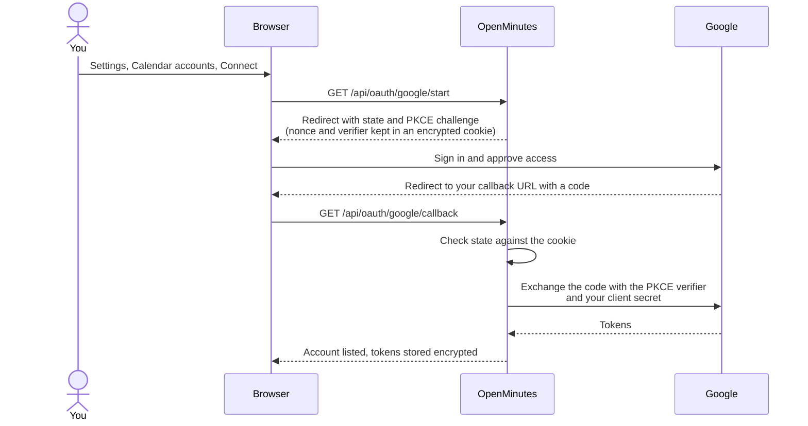

# Create a Google OAuth client

Time: about 15 minutes. Needed for: calendar auto-join, Google Doc export, sending minutes with Gmail.

You create your own Google client, so calendar data only moves between your Google account and your server. You need a Google account and an HTTPS hostname, see [reverse proxy](reverse-proxy.md). `http://localhost` works for testing.

## 1. Create a project

1. Open the [Google Cloud console](https://console.cloud.google.com/) and sign in.
2. In the project picker press New project, name it `OpenMinutes`, press Create and select it.

## 2. Enable the APIs

APIs and services, Library: search each API and press Enable.

| API                                  | Enable it when                                                                    |
| ------------------------------------ | --------------------------------------------------------------------------------- |
| Google Calendar API                  | Always, for calendar sync.                                                        |
| Google Docs API and Google Drive API | You export minutes as Google Docs, see [minutes](minutes.md).                     |
| Gmail API                            | You send minutes through Gmail, see [email](email.md#gmail-the-bots-own-account). |

## 3. Configure the consent screen

Google Auth platform (Branding, Audience, Data access, Clients).

1. Get started (first visit wizard).
2. App information: name `OpenMinutes`, a support email.
3. Audience: Internal for Workspace use only by your organisation, otherwise External.
4. Contact information: a developer email.
5. Data access, Add or remove scopes: paste under Manually add scopes, then Add to table, Update, Save.
6. External app in Testing: add your account under Audience, Test users.

| Scope                                                                                        | Add it for                                                                                        |
| -------------------------------------------------------------------------------------------- | ------------------------------------------------------------------------------------------------- |
| `openid`, `email`                                                                            | Always.                                                                                           |
| `https://www.googleapis.com/auth/calendar.readonly`                                          | Calendar sync (read only).                                                                        |
| `https://www.googleapis.com/auth/drive.file` and `https://www.googleapis.com/auth/documents` | Google Doc export. Requested only when you press Connect with export access in Settings, Minutes. |
| `https://www.googleapis.com/auth/gmail.send`                                                 | Gmail sending. Requested only when you connect Gmail under Settings, Email.                       |
| `https://www.googleapis.com/auth/calendar.events`                                            | Optional, minutes link in the calendar (below).                                                   |

Optional: minutes link in the calendar

For Settings, Minutes, Export, Add the minutes link to the calendar event, add `https://www.googleapis.com/auth/calendar.events` under Data access. It is requested only on Allow calendar links in Settings, Minutes, Export, and added to what the account already granted. Other accounts stay read-only, and the meeting page says editing is not allowed.

- Only the event description is edited, with `sendUpdates=none`: no change email to guests.
- Guests who may not edit get a 403 and the meeting page says "Could not add link to calendar (no permission)".

## 4. Create the OAuth client

1. Clients, then Create client.
2. Application type: Web application.
3. Authorised redirect URIs: `<your OpenMinutes URL>/api/oauth/google/callback`, for example `https://openminutes.example.com/api/oauth/google/callback`. Settings, Calendar accounts shows the exact URI with a Copy button. It must match character for character (scheme, port, path).
4. Create, then copy the client ID and client secret. The secret is shown once.

## 5. Give it to OpenMinutes

1. Settings, Calendar accounts, Google panel: paste client ID and secret, Save changes, Connect Google.
2. Sign in and tick the calendar box on the permissions screen (each permission has its own checkbox; without it no events are readable).

New calendars start on Never: pick a rule per calendar (all meetings, only meetings you organise, only meetings with external guests, or never).

## How connecting works

## How sync works

Polls every 2 minutes, next 14 days, with Google sync tokens (only changes after the first pass). No webhooks, so your server need not be reachable from Google. Rescheduled and deleted events update or cancel the queued join. Sync now syncs at once. To revoke access fully, also remove OpenMinutes under Security, Third-party access in your Google account.

## If it fails

| Problem                            | Fix                                                                                                                                     |
| ---------------------------------- | --------------------------------------------------------------------------------------------------------------------------------------- |
| `redirect_uri_mismatch`            | Copy the URI again from Settings, Calendar accounts. Behind a proxy set `OPENMINUTES_PUBLIC_URL`, see [reverse proxy](reverse-proxy.md) |
| Calendar access stops after a week | External app in Testing, see below                                                                                                      |
| No calendars after connecting      | The Calendar box was not ticked. Disconnect and connect again                                                                           |
| "Access blocked" / `access_denied` | Your account is not under Audience, Test users                                                                                          |

## Things to know

- External apps in Testing expire refresh tokens after 7 days. Set In production under Audience. That needs home page, privacy policy and terms links in Branding on an Authorised domain. Any page on your host does for personal use.
- "Google hasn't verified this app": click Advanced, then Go to your domain (unsafe). Verification is needed only above 100 users.
- Internal apps have none of these limits.
