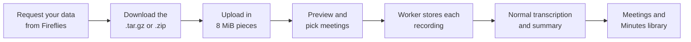

# Import from Fireflies

Time: 10 minutes of your own, plus the wait for Fireflies to send the export.

Bring your Fireflies meetings into OpenMinutes from your account data export. They appear in Meetings and the [Minutes library](minutes-library.md) like any other meeting.

## Get your data from Fireflies

1. Open the [request form](https://9rnxnmmf.paperform.co/) and complete it.
2. Approve the request. Fireflies emails a confirmation with the subject "Action Required - Confirm Your Data Export Request" from `fred@fireflies.ai`. Nothing is processed until you approve it, so check spam if it does not arrive.
3. Within 24 to 48 hours you get an email with a download link. It is valid for 7 days, after that you request again.

Fireflies describes the process in its [export guide](https://guide.fireflies.ai/articles/8915664468-how-to-export-your-fireflies-account-data). The export holds, per meeting, the audio (MP3), the video when available, the transcript with speaker identification, the AI summary, attendee information and metadata in JSON. The guide calls the download a zipped file, some exports are a `.tar.gz`. OpenMinutes takes both.

## Import it

1. Open Meetings, then Import (or Settings, Import).
2. Pick the `.tar.gz` or `.zip`. It uploads in 8 MiB pieces, so it also works behind Cloudflare's 100 MB request limit.
3. Check the preview: title, date, length, attendees, whether a recording exists. Meetings you already imported are skipped. They are matched by the Fireflies id, so importing the same export twice never duplicates a meeting.
4. Tick the meetings. Meetings without a recording are listed as not importable.
5. Answer "How many people speak?". Auto is the default: the voices are counted from the audio. Pick 2 to 5 when you know the number, for example when a two person call came out as nine speakers. The answer applies to every meeting you start in this go, is stored on the meeting and is used when it is transcribed. You can change it later, see [speakers](speakers.md#fixing-the-number-of-people).
6. Start. The worker imports one meeting at a time and the page shows progress. One failing meeting never stops the others, Retry failed runs them again, with the number you chose.

## What is imported

Only the recording and the meeting details come across. The Fireflies transcript and summary are never read. Every imported recording goes through the normal processing, like a phone recording: your own transcription provider and speaker identification, then your summary provider and template. Transcribing takes time, and costs money with a hosted provider, see [providers](providers.md#transcription). Prices per hour of audio: for example `openai` `whisper-1` is $0.36, `local` is free but slow on a small CPU.

| From Fireflies              | In OpenMinutes                                                                                             |
| --------------------------- | ---------------------------------------------------------------------------------------------------------- |
| Recording (`audio.mp3`)     | The audio of the meeting, then transcribed and summarised here. The normal [retention](storage.md) applies |
| Title, start time, duration | Title, start and end of a meeting with the platform Imported                                               |
| Attendee emails             | Invitees of the meeting, never shown on share pages                                                        |
| Fireflies id                | Kept to skip the meeting when you import the same export again                                             |
| Meeting without a recording | Not importable, listed as such                                                                             |

Share, export, AI edit, archive and bin work as usual.

## Privacy

Everything stays on your server. The uploaded files are removed once a meeting is imported, and an unfinished upload after 7 days. The audio goes to the transcription provider you configured and the text to your summary provider.

## Limits

| Limit                | Value                                                                                                                                    |
| -------------------- | ---------------------------------------------------------------------------------------------------------------------------------------- |
| Archive size         | 10 GB by default, change it with `OPENMINUTES_IMPORT_MAX_GB`, see [configuration](configuration.md#environment). Video counts toward it. |
| Files in the archive | 20,000                                                                                                                                   |
| Files that are read  | `audio.mp3` and the metadata file. Video, transcripts, summaries and the rest are ignored                                                |
| Refused archives     | Paths that leave the folder, links, devices and anything that is not a `.tar.gz` or `.zip`                                               |

## Troubleshooting

| Symptom                              | Fix                                                                                                                    |
| ------------------------------------ | ---------------------------------------------------------------------------------------------------------------------- |
| Upload fails early                   | A proxy in front has its own body limit. It must allow at least 8 MiB per request (nginx: `client_max_body_size 16m`). |
| "Larger than the import limit"       | Raise `OPENMINUTES_IMPORT_MAX_GB` and restart web.                                                                     |
| Some meetings are not in the preview | The preview says how many could not be read (no usable metadata). The rest imports normally.                           |
| A meeting shows failed               | Open it for the reason. Retry failed on the import page runs it again.                                                 |
