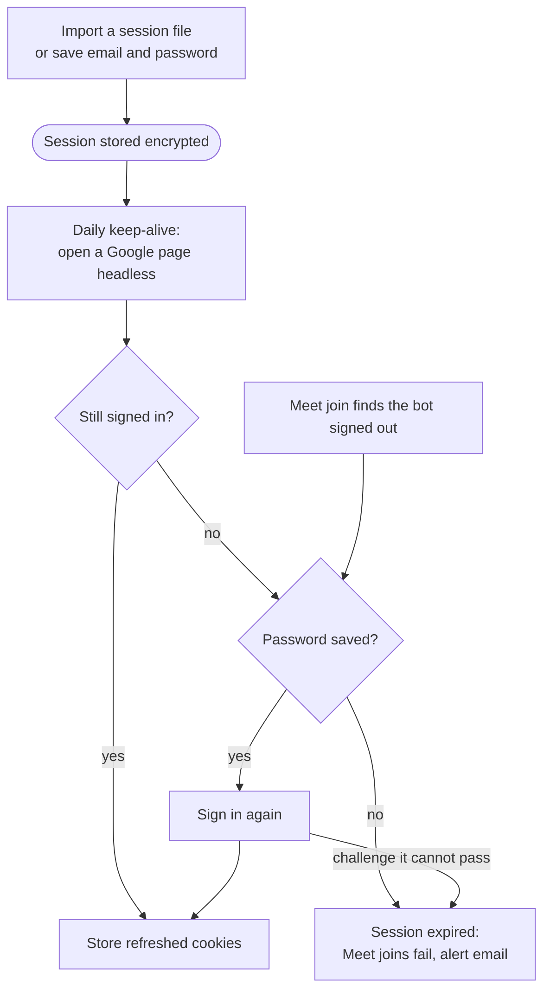

# Signing the Meet bot in

About 20 minutes, plus a few days of use for a new account. Optional for Teams-only setups.

## Why it is needed

Google Meet refuses guests from automated browsers on servers (403, "You can't join this video call"), see [troubleshooting](troubleshooting.md#the-status-says-google-meet-refused-the-request-to-join). A bot signed in to a Google account is judged differently. Without one the bot still tries as a guest. Teams is not affected. Verified on real Google Meet on 2026-10-22; Meet changes without notice.

> [!WARNING]
> Use a dedicated account that exists only for the bot, never your own. Google may lock an account that acts like a bot, and automating a Google account can break the Google Terms of Service. That risk is yours.

## Steps

1. Create a Google account just for the bot. Its name is what others see (for example `OpenMinutes Notetaker`).
2. Add a recovery phone number, optionally 2-step verification, and use it for a few days (Gmail, a Meet call) before automating.
3. Settings, Google Meet sign-in, Sign in with email and password. With an authenticator app, add the Authenticator secret too (the setup key next to the QR code).
4. If Google asks for a step the bot cannot pass (phone check, captcha), use a session file, below.
5. Test: paste a Meet link into Join meeting and admit the bot. The page shows Signed in and the status reaches recording.
6. Keep "Email me when the session fails or is about to run out" on and fill in your address under Settings, Email.

Organisations that only admit members: invite the bot account by email.

## Session file (when email and password is not enough)

Do this on a computer with a display, not the server. Needs Node.js 22 and Chrome, Edge or Playwright Chromium.

1. Run `pnpm install` here, or `npm install playwright-core` in an empty folder with `scripts/google-login.mjs` copied there.
2. Run `node scripts/google-login.mjs` (`--channel msedge` or `--channel chromium` for another browser).
3. Sign in with the bot account in the window that opens. It closes itself and writes `google-session.json`.
4. Settings, Google Meet sign-in: import the file, then delete it. It is stored encrypted with `OPENMINUTES_SECRET`. Remove session signs the bot out, so it joins as a guest.

## How the session is kept

With a saved password, a join that finds the bot signed out signs in and retries once.

- Daily keep-alive opens a Google page headless and stores the refreshed cookies.
- Without a saved password an expired session stays expired until you import a file.
- The owner address gets an email when the keep-alive fails, the bot is signed out for good, a join fails because of the session, or the earliest cookie ends within 72 hours. At most one per day.

Trade-offs of saving the password:

- Password and authenticator secret are encrypted, never shown, but whoever has the database and `OPENMINUTES_SECRET` can read them.
- With the authenticator secret saved next to the password, 2-step verification no longer protects against a server leak. Leave it out if you have no 2-step verification.
- A data center sign-in may trigger a challenge. The bot then shows Needs attention with the reason and emails you.

## Session status

| State             | Meaning                                                                                                             |
| ----------------- | ------------------------------------------------------------------------------------------------------------------- |
| No Google account | The bot joins Meet as a guest                                                                                       |
| Signed in         | The sign-in cookies have not run out (checked offline)                                                              |
| Signed out        | Cookies ran out or a join found the bot signed out. Meet meetings fail with "The Google session of the bot expired" |

A new file, a successful keep-alive or an automatic sign-in clears it.

## When signed in

- The bot opens the Meet link with the session. Others see the Google account name, so the Bot identity display name applies to guests only.
- With Join now (host's organisation admits the account) it joins at once; with Ask to join it waits in the lobby like a guest.
- It mutes the microphone, and the camera unless you set a camera image.

## When it fails

- "The Google session of the bot expired": run the script again and import the new file.
- "Google Meet refused the request to join": check the account can join the same meeting in a normal browser and has no pending security prompt.
- Nothing happens after import: the file must be a storage state with Google sign-in cookies. The import says what is missing.

What the real flow looks like (live test, fresh Gmail account)

- Sign-in asked only for the password, then a skippable "Set a home address" page. A new account may get a phone challenge, especially from a datacenter.
- Prejoin shows the account name and one button: `Ask to join`, or `Join now` when the host's organisation admits the account.
- In the lobby chat is disabled. The host sees "1 guest waiting" and presses `Admit`.
- In the call the bot's tile carries the account name, not the Settings display name.
- With the calendar rule "Only meetings I organize" the bot joined about a minute before the start.
- Meet may redirect to `meet.google.com/meet/abc-defg-hij`: paste the short link.
- The authenticator code step has not been run against real Google: report what you see if it fails.

Maintainers: the live test procedure is in `docs/maintainers.md` in the repository.
