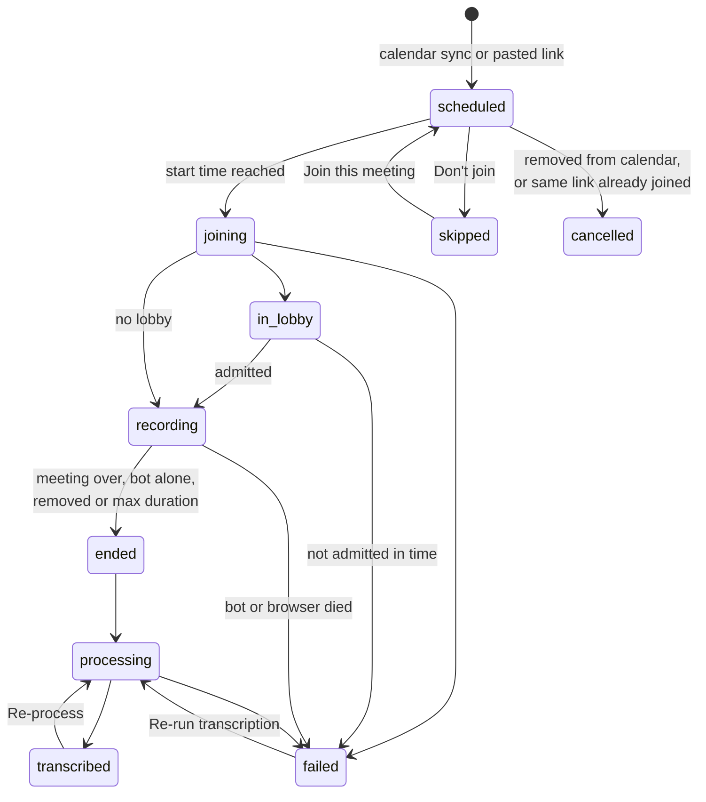
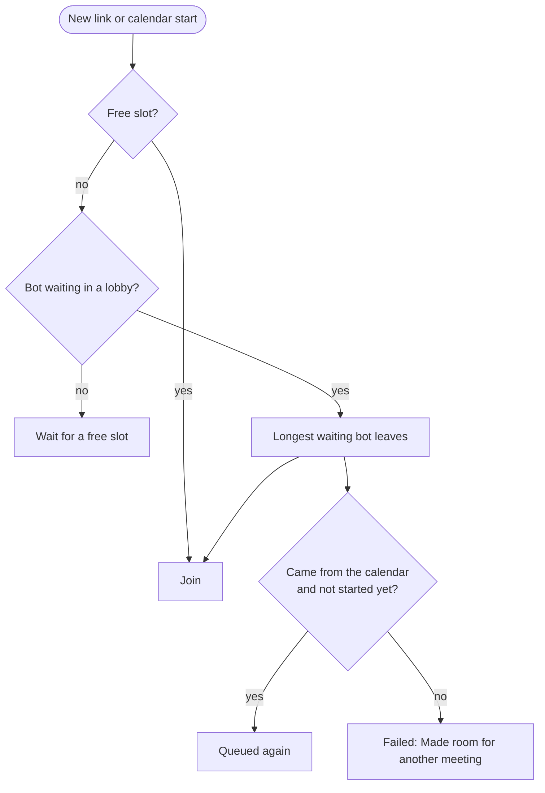

# Meeting lifecycle, skipping and stuck meetings

The status on the meeting page shows where a meeting is and, when it failed, why.

| Status                | Meaning                                                               |
| --------------------- | --------------------------------------------------------------------- |
| `scheduled`           | Queued. The join job runs one minute before the start.                |
| `skipped`             | You chose not to join. Tracked, greyed out, never queued.             |
| `cancelled`           | Gone from the calendar, or the bot already joined this link.          |
| `joining`, `in_lobby` | Opening the link or waiting to be admitted.                           |
| `recording`           | Capturing audio and speaker events.                                   |
| `ended`, `processing` | Audio is merged and transcribed, speakers aligned.                    |
| `transcribed`         | Transcript saved. A summary is requested if a provider is configured. |
| `failed`              | Error shown on the meeting page. Audio so far is kept.                |

Phone recordings use the same states, starting in `uploading` and going to `ended` on stop.

## Skipping a meeting

Click the Auto-join pill on an upcoming meeting (in the Upcoming list or on its page):

| Choice                                | Effect                                                                               |
| ------------------------------------- | ------------------------------------------------------------------------------------ |
| Join this meeting                     | The bot joins at the start.                                                          |
| Don't join this meeting               | Skipped, never queued.                                                               |
| Don't join any meeting of this series | For recurring events. All upcoming occurrences are skipped, new ones arrive skipped. |

- The Recent list on the Meetings page only shows meetings the bot joined or tried to join. Skipped and Cancelled are hidden by default: skipped ones sit under Upcoming, and the Status menu above the list can include them. The choice is remembered in this browser, Reset brings back the default.
- A skipped meeting stays tracked (title and time still update) but a sync never queues it, whatever the join rule says.
- Join this meeting reschedules it while the start is ahead. After the start, paste the link into the Join meeting box.
- Skipped series are listed under Settings, Calendar accounts, Recurring meetings the bot skips. Rejoin there or from any occurrence's Auto-join menu.
- Delete is offered only for meetings that have happened: it asks, then bins the meeting for 30 days and stops its share links. See [Archive and bin](archive-and-bin.md).

How a series is recognised

By the recurring event id (`recurringEventId` for Google, `seriesMasterId` for Microsoft). Events without one are single meetings. One series seen through two calendars can carry two ids: skip each.

## When the bot cannot get in

Settings, General, Meeting limits sets the lobby wait (default 10 minutes), how long the bot stays alone (default 60 seconds) and its longest stay. If nobody admits the bot in time, the meeting fails with `Nobody admitted the bot within 10 minutes` and the browser closes.

## The watchdog

The bot enforces limits itself, but a crashed browser could leave a meeting stuck. So the worker checks every minute, independent of the bot, and fails:

| Situation                                                 | Limit                                            |
| --------------------------------------------------------- | ------------------------------------------------ |
| Joining or in the lobby                                   | Longer than the lobby wait plus 2 minutes        |
| Joining, in the lobby or recording, with no bot heartbeat | 90 seconds (the bot writes one every 15 seconds) |
| Recording                                                 | Longer than the maximum duration plus 10 minutes |

The bot closes its browser at its next heartbeat. Audio so far is kept. The check also runs at worker startup, and a restarting bot fails everything it left running.

## Making room

Bots that are recording, admitted or still joining are never sent away. The failed meeting says `Made room for another meeting after waiting N minutes in the lobby`.
