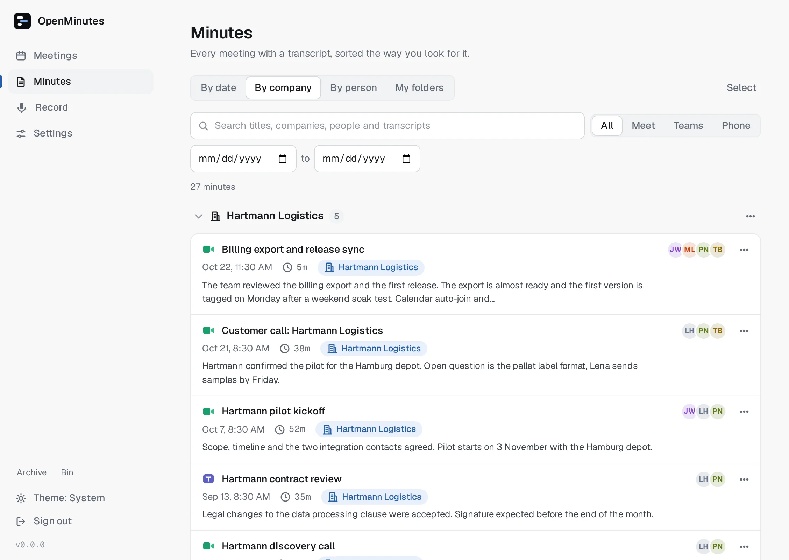
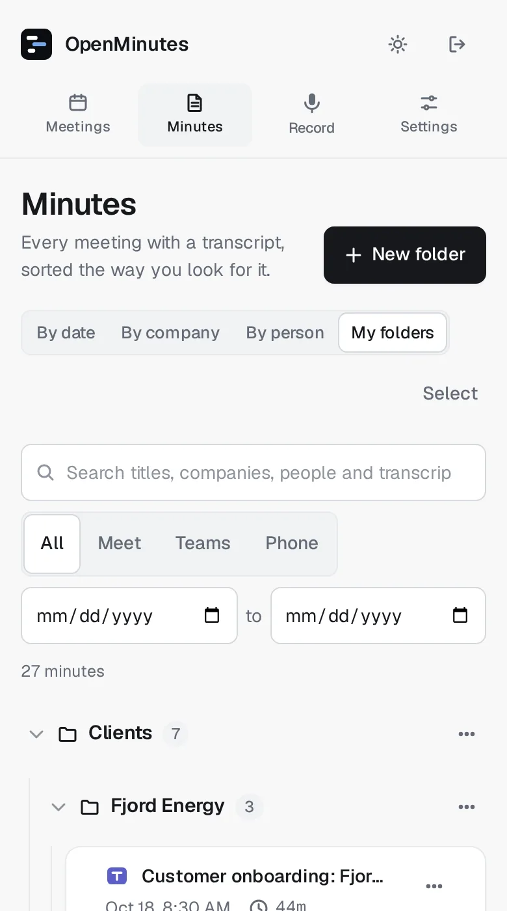
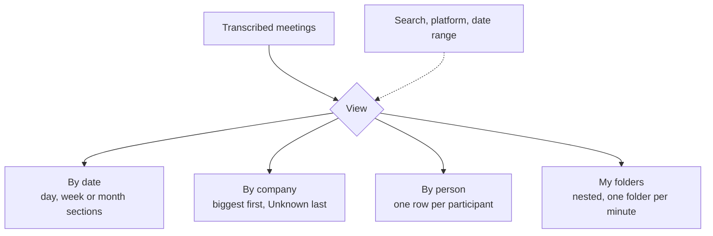

# Minutes library

The Minutes tab lists meetings with a transcript, and only those. Queued, running, failed or speechless meetings stay in the Meetings tab.

<picture>
  <source media="(prefers-color-scheme: dark)" srcset="images/minutes-library-dark.webp">
  
</picture>

<picture>
  <source media="(prefers-color-scheme: dark)" srcset="images/minutes-library-m-dark.webp">
  
</picture>

## Views

Four views, bookmarkable (`#/minutes/date`, `company`, `person`, `folders`).

- **By date.** Newest first, in collapsible sections with a count. Grouping adapts: up to six minutes per day, else per week while a week holds about three or more, a long thin history per month. Group overrides.
- **By company.** Biggest first. Minutes without one go to Unknown company at the end, where each row has a Which company? button.
- **By person.** A minute appears under every person in it, by participant name, so naming a voice in Who is who changes it here. Spellings differing only in case or spacing merge. Unnamed speakers ("Speaker 1") are left out.
- **My folders.** Nested folders plus Unfiled, one folder per minute. Drag a row onto a folder header, or Move to folder in the row menu (the only way on a phone). The folder menu renames, adds a subfolder or deletes. Deleting a folder never deletes minutes: they and its subfolders move up one level.

Search covers titles, companies, participant names and transcripts. Filter by platform and date range.

## Where the company comes from

After a summary is written, the worker fills an empty company in this order. A company you set is `manual` and is never overwritten.

| Step             | How                                                                                                                                                                                                                                                 |
| ---------------- | --------------------------------------------------------------------------------------------------------------------------------------------------------------------------------------------------------------------------------------------------- |
| 1. Calendar      | Invitee email domains, minus free mail providers, resources and your own domains. One outside domain gives the company (`hartmann-logistics.de` becomes Hartmann Logistics). Else patterns in the title such as `Customer call: Hartmann Logistics` |
| 2. Summary model | Title and summary only. Used only if the name is found literally in the title, summary or transcript. Never replaces an existing company                                                                                                            |
| 3. You           | Unknown companies are asked on the meeting page and in the Minutes tab                                                                                                                                                                              |

New names match existing ones ignoring legal suffixes ("Kestrel" joins "Kestrel B.V."). Older meetings have no company until you set one.

## Renaming and merging companies

In By company, a section menu has Rename or merge. The new name applies to every minute of that company. Use another company's name to merge: rename Kestrel B.V. to Kestrel and both share one heading. Renamed minutes become `manual`.

## API

All routes need a session and live under `/api/library`.

| Route                                 | What it does                                                                                  |
| ------------------------------------- | --------------------------------------------------------------------------------------------- |
| `GET /library?q=&platform=&from=&to=` | Transcribed minutes (newest first), all folders and companies in use. Dates are `YYYY-MM-DD`. |
| `POST /library/folders`               | `{name, parentId?}` creates a folder.                                                         |
| `PATCH /library/folders/:id`          | `{name}` renames it.                                                                          |
| `DELETE /library/folders/:id`         | Deletes it, moving minutes and subfolders up one level.                                       |
| `PUT /library/meetings/:id/folder`    | `{folderId}` or `null` moves a minute.                                                        |
| `PUT /library/meetings/:id/company`   | `{company}` or `null` sets it by hand.                                                        |
| `POST /library/companies/rename`      | `{from, to}` renames or merges a company.                                                     |

Meeting detail also returns `company` with `name`, `source` and the suggestions.
