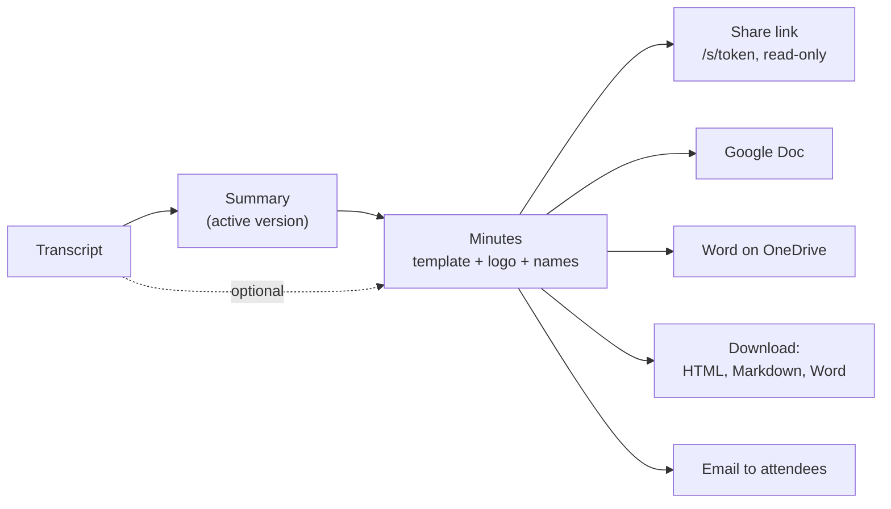
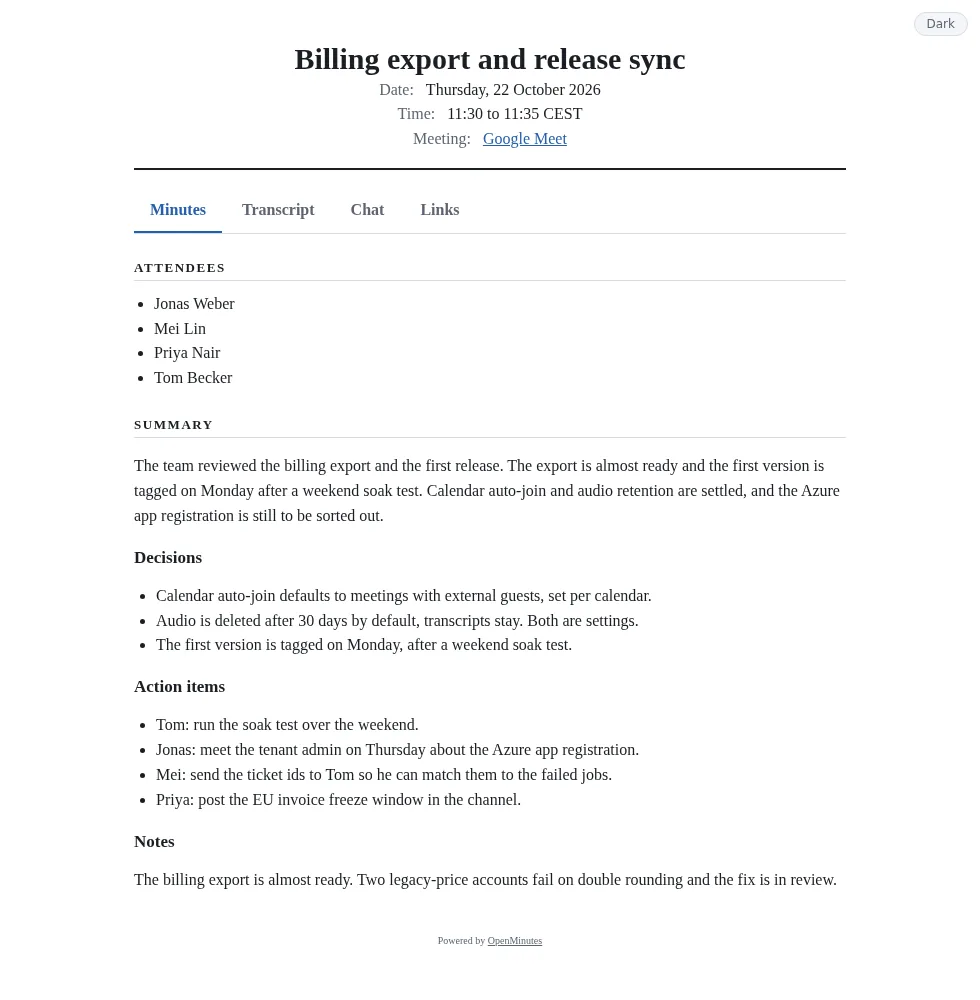
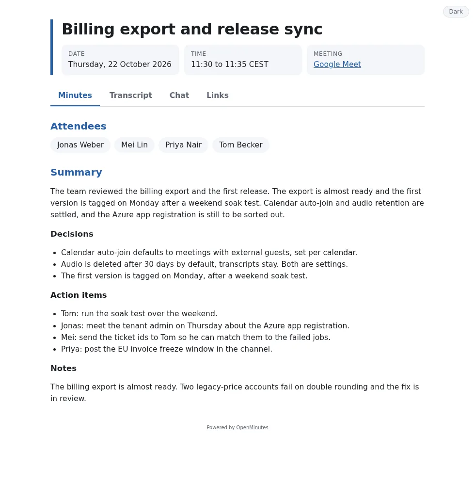
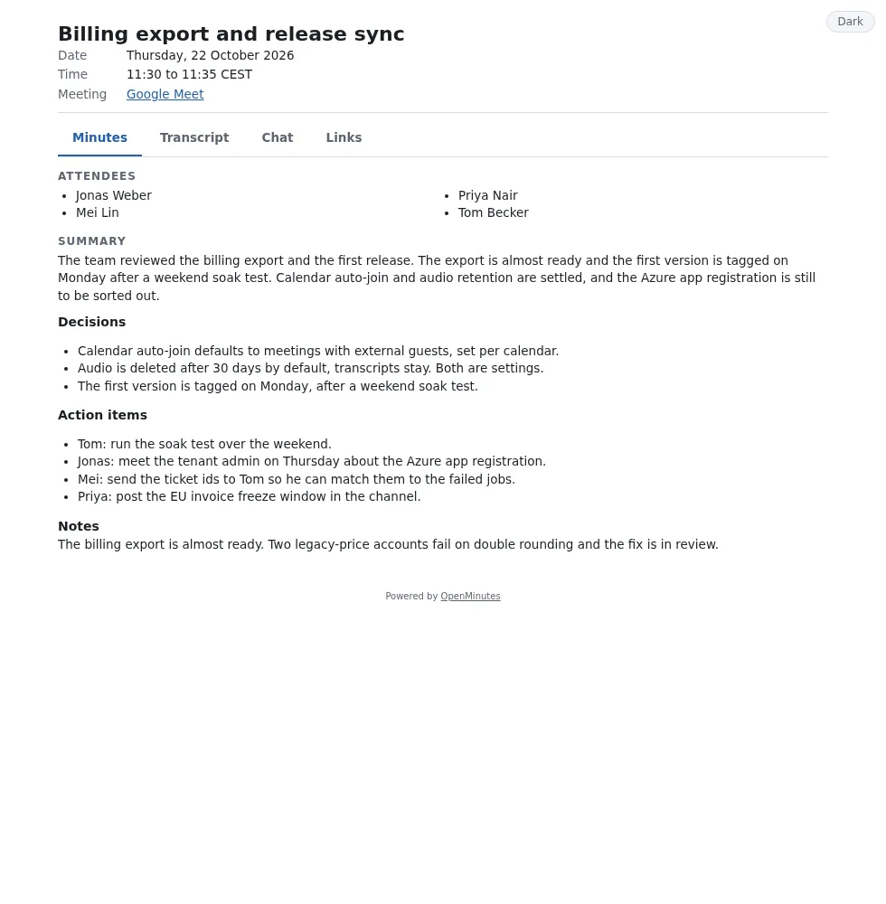
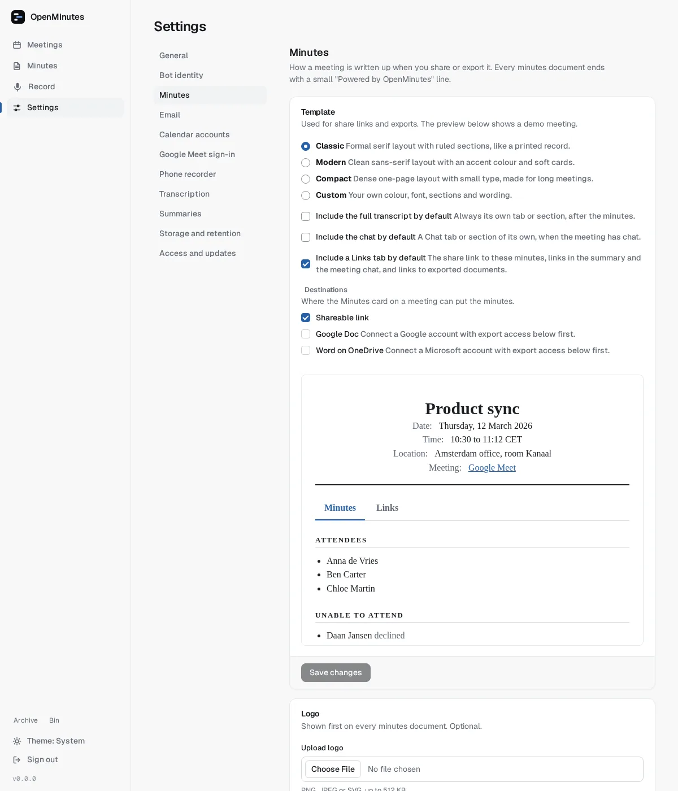
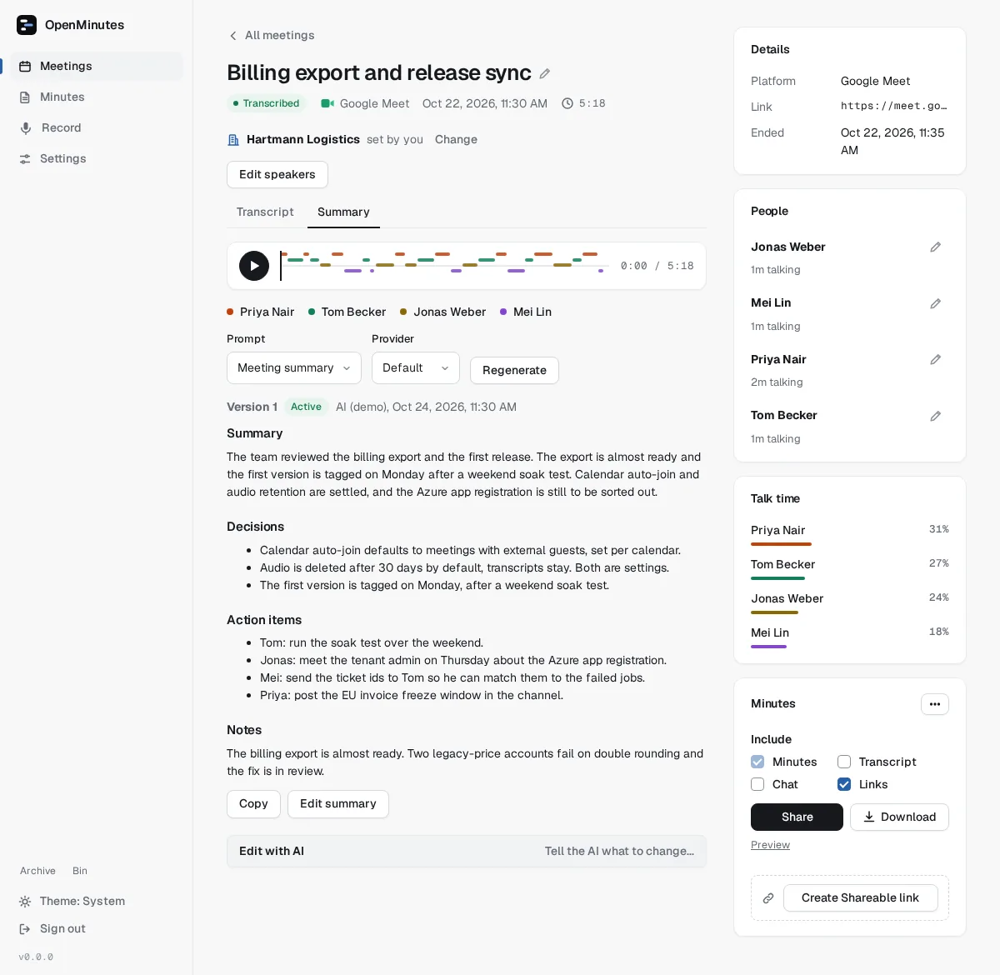
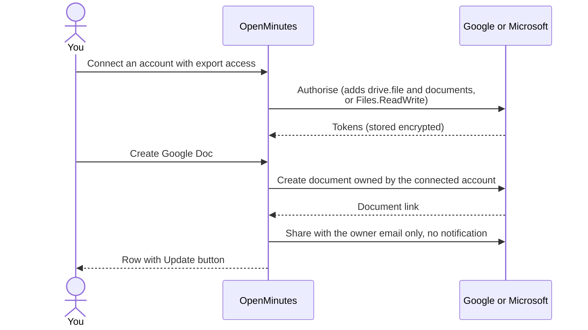
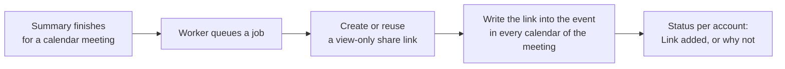

# Minutes, sharing and exporting

Turn a meeting into a minutes document, then share or export it. Only you see it until you create a share link or export it.

Contents: logo, title, date and time, location, attendees, absentees, summary (decisions and action items), optionally the transcript and chat. A "Powered by OpenMinutes" line closes every output and cannot be switched off.

Classic:

<picture>
  <source media="(prefers-color-scheme: dark)" srcset="images/minutes-classic-dark.webp">
  
</picture>

Modern:

<picture>
  <source media="(prefers-color-scheme: dark)" srcset="images/minutes-modern-dark.webp">
  
</picture>

Compact:

<picture>
  <source media="(prefers-color-scheme: dark)" srcset="images/minutes-compact-dark.webp">
  
</picture>

Share pages follow the reader's light or dark mode, so every template has both looks.

## Where the names come from

| Part             | Source                                                                                          |
| ---------------- | ----------------------------------------------------------------------------------------------- |
| Attendees        | People the bot saw, matched to the invite by email or name. The bot is never listed.            |
| Unable to attend | Invitees not seen in the call, decliners marked as declined.                                    |
| No call data     | If the bot saw nobody: non-decliners attend, decliners are unable to attend.                    |
| Location         | Calendar location plus platform and link, stored at calendar sync, so older meetings have none. |

Times in shared pages, exports and emails use the instance timezone and show its name (`12:59 to 13:26 CEST`). Order: Settings, General, Timezone, then `TZ`, then UTC. The app itself uses your browser's zone.

## Settings

Settings, Minutes:

| Setting                                              | What it does                                                                                                   |
| ---------------------------------------------------- | -------------------------------------------------------------------------------------------------------------- |
| Template                                             | Classic (formal serif), Modern (accent colour, soft cards), Compact (dense) or Custom. Live preview.           |
| Destinations                                         | Shareable link (default), Google Doc, Word on OneDrive. The last two need an account with export access.       |
| Logo                                                 | PNG, JPEG or plain SVG up to 512 KB. SVG with scripts or embedded objects is refused.                          |
| Include the transcript / chat / Links tab by default | Defaults of the Include boxes (`minutes.include_chat`, `minutes.links_tab`). All off until you switch them on. |

<picture>
  <source media="(prefers-color-scheme: dark)" srcset="images/minutes-settings-dark.webp">
  
</picture>

**Custom** opens a builder: accent colour, font, logo position, section order and visibility, editable titles and labels, text above and below, date format. **Export template** and **Import template** move it between instances as JSON. A template is plain data, never HTML or CSS. Every template prints cleanly.

### Choosing what goes in

The **Include** row on the Minutes card has the minutes (always on) and, when the meeting has them, **Transcript**, **Chat** and **Links**. One choice applies to Share, Preview, Download and documents. Each part is its own page or tab, never mixed into the minutes.

To change an existing output, change the boxes and press **Apply include** on the share link (or **Update** on a document). The address stays the same. API: `PATCH /api/meetings/<id>/shares/<shareId>` with `includeTranscript`, `includeChat`, `includeLinks`.

## Editing the minutes

Edit the title, summary and action items on the meeting page. Every save is a new summary version, and **Edit with AI** rewrites from an instruction, see [summaries](summaries.md).

## Share links

Switch on Shareable link under Settings, Minutes, Destinations (on by default), then press **Create shareable link** in the Minutes card.

<picture>
  <source media="(prefers-color-scheme: dark)" srcset="images/minutes-share-dark.webp">
  
</picture>

A link is `https://<your instance>/s/<token>` (256 bit random). It is read-only, needs no login, always shows the active summary version, can be revoked, and goes away with the meeting. Revoked, expired and unknown links all show the same "not available" page. Pages send `noindex`, `no-store` and `no-referrer`.

> [!WARNING]
> Anyone with the link can read the minutes. Treat it like the minutes themselves.

Behind Cloudflare Access, outsiders need a bypass for `/s/*`, see [Cloudflare Access](reverse-proxy.md#cloudflare-access-sign-in-by-cloudflare). To email minutes, see [email](email.md).

## Exporting

The Minutes card has **Share**, a **Download** menu and **Preview**. Each enabled destination is a row with last update time, **Update** and a menu with **Create new copy**.

| Format           | What you get                                         |
| ---------------- | ---------------------------------------------------- |
| HTML             | One self-contained page, logo inlined                |
| Markdown         | Plain text for notes and wikis                       |
| Word             | A `.docx`, transcript (and chat) as a second section |
| Share link       | Read-only page                                       |
| Google Doc       | A living copy                                        |
| Word on OneDrive | The `.docx` uploaded to OneDrive                     |

### Google Docs and OneDrive

Settings, Minutes, Export sets the default target, the creating account and the owner email.

> [!IMPORTANT]
> Calendar connections are read-only. Press "Connect a Google account with export access" (or Microsoft) in Settings, Minutes, Export. It adds to the existing grant, so the calendar keeps working. For Google also enable the Docs and Drive APIs, see [google-oauth](google-oauth.md).

- Update rewrites the same document (comments and sharing stay). Create new copy makes another.
- The connected account owns it. Otherwise it is shared with the owner email only, as editor, without a notification.
- "Create the minutes automatically when a summary is ready" is off by default. Under it, "Send them to the export target above" exports to the target (Google Doc, OneDrive or Share link) and "Add the minutes link to the calendar event" is described below. Downloads cannot be automatic.
- Google Docs: "Powered by OpenMinutes" is in the footer. Transcript, Chat and Links get their own tabs. SVG logos are skipped (Docs rejects SVG).
- OneDrive: the `.docx` goes to `OpenMinutes/` (up to 4 MB).

## Minutes link in the calendar

Settings, Minutes, Export, under "Create the minutes automatically when a summary is ready": "Add the minutes link to the calendar event" (off by default). It is its own switch next to the export one, so each does only what it says. The card has one Save changes button, like every card in Settings.

- Needs `OPENMINUTES_PUBLIC_URL`. The link has no expiry and shows the latest active version.
- It is written at the end of the event description as `Minutes (OpenMinutes): <link>`. Reruns replace that block.
- A meeting in several calendars gets the link in each, see [duplicate meetings](duplicate-meetings.md).
- Press Allow calendar links to grant `calendar.events` (Google) or `Calendars.ReadWrite` (Microsoft). Google sends no update mail. Microsoft cannot suppress it, see [azure-app](azure-app.md).
- The meeting page shows the status per calendar. **Add link to calendar now** reruns it. Temporary failures retry 5 times.

Developers: see "Writing an exporter" in `docs/maintainers.md` in the repository.
