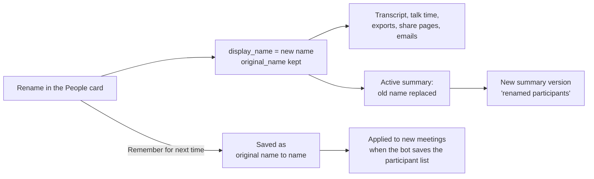
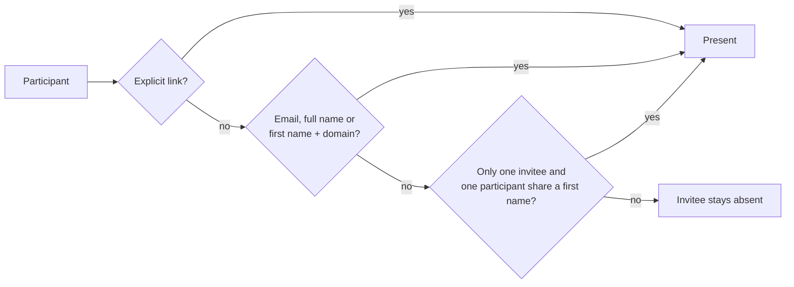

# Participant names

Calendar meetings show a **People** card with everyone who joined, when they joined and left, and how long they spoke. Use the pencil (Edit) to rename someone, for example "Carla" instead of the Meet display name "Marketing Acme".

## What changes

- The original name stays in `participants.original_name`. The new `display_name` counts as confirmed, like a named voice on a phone recording.
- Transcript, talk time, exports (Markdown, JSON, HTML, Word, Google Docs), share pages and emails use the new name. The attendees list shows `Carla (Marketing Acme)` when they differ. The Minutes library groups by the new name.
- The notetaker (`participants.is_bot`, matched on the configured bot name, the default names and a Teams "(Guest)" suffix) is stored but never counted or listed.

## The summary follows

Renaming replaces the old name in the active summary and saves a new version, "renamed participants". Earlier versions stay. The new one becomes the single active version, also if the active one was edited by hand. A summary being generated is left alone. The app then offers to regenerate the summary, which gets the participant names in its prompt.

## Remember for next time

On by default in the rename dialog. It stores `original name -> name` and applies it to new meetings. Edit or forget names under Settings, Summaries, People. Renaming back to the original name with the box checked forgets the entry.

## Who was invited

The minutes list calendar invitees who did not show up under **Unable to attend**. An invitee counts as present when a participant is matched to them, in this order:

1. An explicit link you set (always wins).
2. The same email.
3. The same full name (display name or the name they joined as), or the same first name on the same email domain.
4. The same first name, only when it is unambiguous: one invitee and one participant, case and accents ignored.

A shared account such as "Marketing Acme" renamed to "Carla" matches the invitee "Carla Gonzalez" by first name. When that is not enough (two invitees called Carla), fix it by hand:

- In the rename dialog tick **Which invitees is this?**. One person can be several invitees (work and private email). A single match by first name is pre-ticked. With **Remember for next time** the shared account name maps to those invitees for future meetings.
- Someone who is not on the invitation can get an email address in the same dialog. It is used for the minutes recipients, and with **Remember for next time** it is stored with the name and, when the voice is known, with the saved voice.
- **They were there** adds the invitee to the participant, so earlier links stay.
- On the People card, the **Unable to attend** list has a menu per invitee: **They were there** (choose the participant) and **Remove from list**. Removing is per meeting and applies to exports, share pages, emails and Google Docs.

## Privacy

Calendar email addresses are never printed in shared or exported minutes: share pages, HTML, Markdown, Word, Google Docs and emails show names only. An invitee without a display name appears as the formatted local part of the address ("Carla Gonzalez" for `carla.gonzalez@...`). The People card in the app shows addresses to the owner.

## Edit a speaker

Every speaker row has an **Edit** button, in the People card and in the **Talk time** panel (so also for phone recordings and imports, which have no People card). The dialog shows:

- **Name.** Renames the speaker in this meeting exactly like the rename above. When the name is someone who exists already, the dialog says so: saving joins the speaker with that person and keeps their addresses. Two voices of a recording that get one name are merged.
- **Emails.** The addresses bound to the person behind the speaker. Add one, tap an invitee of this meeting (marked Invited), or remove one (asks first). An address another person has already is greyed out with their name, and saving it is refused. Removing an address takes it off the person in People too.
- **Open on People** jumps to the person.

Save does the rename and the email changes in one request (`PUT /api/meetings/:id/participants/:participantId/identity`, owner only like the other routes). A speaker without a person gets one when it is saved with a real name; a generic "Speaker 2" cannot have emails. The voices of a shared account keep their own naming flow, so their name is fixed in this dialog and only the emails change. If the summary mentioned the old name, the app offers to regenerate it as after any rename.
