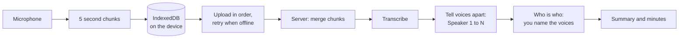
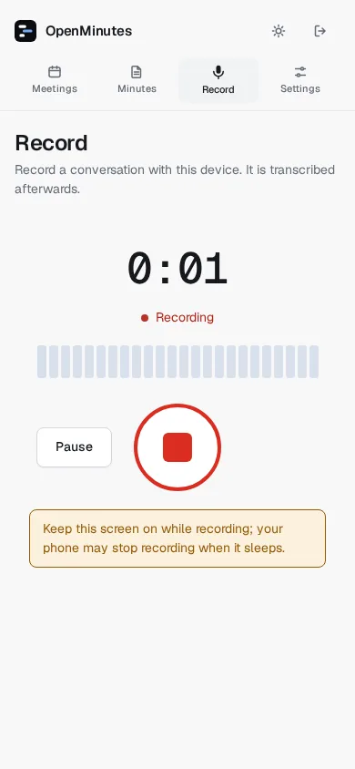
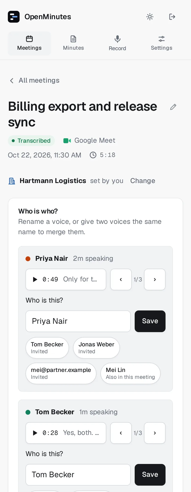

# Phone recorder

Time: 5 minutes once HTTPS works, see [reverse proxy and HTTPS](reverse-proxy.md).

Record a conversation on your phone (or any browser with a microphone) and get minutes as for a bot meeting. It is an installable web app (PWA): no app store, and Record works offline.

## Requirements

- HTTPS (microphone, service workers and install need a secure origin). `http://localhost` works, a plain `http://` network address does not.
- A browser with `MediaRecorder`: Chrome and Edge on Android, Safari 14.5 or newer on iOS, current desktop browsers.
- Phone recording on (default). When off, Record disappears and `#/record` shows a notice.

## Install it on your phone

- iPhone or iPad (Safari): Share, then Add to Home Screen.
- Android (Chrome): menu, then Install app (or Add to Home screen). Long press the icon for a Record shortcut.

> [!NOTE]
> Behind Cloudflare Access, sign in once in the browser first. If Access redirects the service worker or manifest to its login page, nothing is cached and the app works from the network.

## Record

1. Open Record (top bar on a phone, or `#/record`).
2. Read the consent reminder and tap I understand, start recording. The browser asks for the microphone the first time.
3. Pause and Resume if needed (paused time is not counted). Stop ends the recording, with a confirmation under three seconds.
4. The app uploads the rest and opens the new meeting, processing until the minutes are ready.

"How many people are talking?" takes Auto (default), 2, 3, 4 or 5+. Use 2 for two people at a table: one microphone hears a quiet second voice as part of the loud one. The choice is remembered on the device and saved with the recording. Change it later from More, Re-process with 2 speakers.

The level meter shows whether the microphone hears anything. Echo cancellation, noise suppression and automatic gain are on.

## Keep the screen on

> [!WARNING]
> Phones suspend web pages in the background or when the screen locks. On iOS this stops the recording, Android is more forgiving but not reliable. Keep the screen on and OpenMinutes in the foreground until you press Stop.

- The app asks for a Screen Wake Lock while recording. Older iOS lacks it and shows a warning.
- Warnings appear if the page was hidden or less audio was saved than time has passed. Closing the page asks for confirmation.
- Plug in for long meetings.

## Offline and recovery

Audio is cut into 5 second chunks, saved in the browser (IndexedDB) and uploaded in order.

| Situation                     | What happens                                                                                                     |
| ----------------------------- | ---------------------------------------------------------------------------------------------------------------- |
| No connection                 | Recording continues. Uploads retry with a growing delay (1 s up to 30 s), and at once when back online.          |
| Server error (5xx)            | Retried the same way.                                                                                            |
| Error retrying cannot fix     | Upload stops, the recording stays on the device and the message is shown.                                        |
| App restarted                 | It asks the server which chunks it has and sends the rest. Uploading a chunk twice is harmless.                  |
| Server reports chunks missing | After the finished recording was accepted, those chunks are sent again. Local chunks are kept until then.        |
| Opened offline                | The app shell is cached and Record works with the consent text it saw last. It uploads when you are back online. |

After a crash, restart or dead battery, the next start shows "Upload unfinished recording? (12:03, 8m)". Upload finishes it with the saved audio, Discard deletes it from device and server. Up to 5 seconds after the last saved chunk is lost.

## Storage and limits

- The service worker caches only the app shell, never `/api`, share links or audio.
- Recordings stay on the device only until uploaded. Clearing browser data deletes unfinished ones.
- About 15 to 30 MB per hour: prefer Wi-Fi for long meetings.

## Privacy and consent

> [!IMPORTANT]
> Recording people without telling them is illegal in many places. You must inform everyone and get consent. The reminder shown before every recording is editable in Settings. See [Consent and legal notes](consent-and-legal.md).

There is no analytics or telemetry. Audio goes only to your own server.

## Speakers and names

One microphone, so voices are separated by sound, see [speakers](speakers.md) and [Voices](voices.md).

<picture>
  <source media="(prefers-color-scheme: dark)" srcset="images/phone-record-dark.webp">
  
</picture>

<picture>
  <source media="(prefers-color-scheme: dark)" srcset="images/phone-who-is-who-dark.webp">
  
</picture>

## Troubleshooting

| Symptom                               | Fix                                                                                                                                        |
| ------------------------------------- | ------------------------------------------------------------------------------------------------------------------------------------------ |
| "Recording needs a secure connection" | Open OpenMinutes over HTTPS.                                                                                                               |
| Microphone blocked                    | Allow it for the site (iOS: Settings, Safari, Microphone; Android: lock icon in the address bar). Installed iOS app: remove and add again. |
| Recording shorter than the meeting    | The phone suspended the page. Keep the screen on next time.                                                                                |
| Record button missing                 | Phone recording is off in Settings, or the setting has not loaded yet (open the app once online).                                          |
| App does not update                   | Close it fully and reopen. A new version is picked up on the next online start.                                                            |
| Upload stuck                          | Check the connection. On an error the recording stays on the device, listed as unfinished.                                                 |
