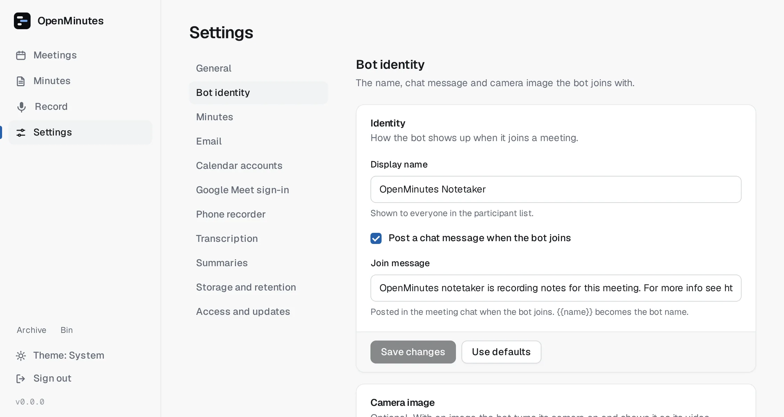
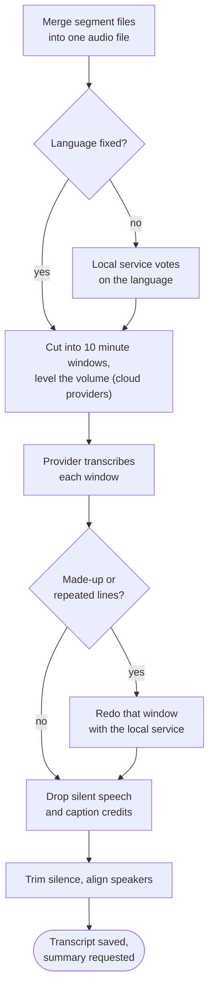

# Providers

Time: 5 minutes. Pick a transcription provider (required) and optionally a summary provider.

<picture>
  <source media="(prefers-color-scheme: dark)" srcset="images/settings-dark.webp">
  
</picture>

## Transcription

Settings, Transcription. Default is `local`. Keys are stored encrypted and never shown again: leave a field blank to keep it. Test checks the form values without spending tokens.

Prices are per hour of audio, from each provider's pricing page in October 2026. They change, so check before you commit.

| Provider     | Model                     | Needs   | Per hour       | Notes                                                                                                    |
| ------------ | ------------------------- | ------- | -------------- | -------------------------------------------------------------------------------------------------------- |
| `local`      | `small` by default        | Nothing | Free           | faster-whisper, runs on your CPU after the meeting, no data leaves. Needs the whisper service, see below |
| `openai`     | `whisper-1` (recommended) | API key | $0.36          | Word timestamps                                                                                          |
| `openai`     | `gpt-4o-transcribe`       | API key | $0.36          | No word timestamps                                                                                       |
| `openai`     | `gpt-4o-mini-transcribe`  | API key | $0.18          | No word timestamps                                                                                       |
| `groq`       | `whisper-large-v3-turbo`  | API key | $0.04          | Fastest and cheapest hosted                                                                              |
| `groq`       | `whisper-large-v3`        | API key | $0.111         |                                                                                                          |
| `deepgram`   | `nova-3`                  | API key | $0.26          | Monolingual, pay as you go (multilingual $0.31). Can diarize                                             |
| `assemblyai` | Universal                 | API key | $0.15 to $0.21 | Plus $0.02 per hour for speaker identification. Can diarize                                              |

Sources: [OpenAI](https://developers.openai.com/api/docs/pricing), [Groq](https://console.groq.com/docs/speech-to-text), [Deepgram](https://deepgram.com/pricing), [AssemblyAI](https://www.assemblyai.com/pricing).

### Which one

| You want                                     | Pick                                             |
| -------------------------------------------- | ------------------------------------------------ |
| No key, full privacy                         | Local                                            |
| Cheapest hosted                              | Groq turbo                                       |
| Best speaker separation for phone recordings | Deepgram or AssemblyAI with Identify speakers on |
| You already have an OpenAI key               | whisper-1                                        |

**Language** (Settings, Transcription): leave Auto-detect (default) unless detection keeps getting it wrong.

**Base URL**: hosted providers use their public address. Under Advanced you can route them through a proxy. For the local service and OpenAI-compatible summaries it is always shown.

### Local whisper service

It sits behind the `local` compose profile:

```sh
docker compose --profile local up -d
```

- The model downloads on first use. `WHISPER_MODEL` (`tiny` to `large-v3`, default `small`) in `.env` changes it.
- It runs `int8` on CPU. `WHISPER_COMPUTE_TYPE=float32` (or `float16` on a GPU) changes that.
- Default address `http://whisper:8000`.

### After a meeting



Files over 24 MiB are re-encoded and split for providers with an upload limit. If the provider fails, the meeting keeps its audio and any earlier transcript: fix the setting and press Re-run transcription. Speaker names come from the meeting page, see [speakers](speakers.md).

## Summary

| Provider          | Needs                   | Notes                                                   |
| ----------------- | ----------------------- | ------------------------------------------------------- |
| `none`            | Nothing                 | Default.                                                |
| OpenAI-compatible | Base URL, key and model | Covers OpenAI, DeepSeek, Ollama, OpenRouter and others. |
| `anthropic`       | API key                 | Claude models.                                          |

DeepSeek is text only: summaries, not transcription.

### Summary setup values

For OpenAI-compatible, fill in Base URL, API key and Model, then press Test connection and Save changes.

| Service  | Base URL                               | Model example                         | Key         |
| -------- | -------------------------------------- | ------------------------------------- | ----------- |
| OpenAI   | `https://api.openai.com/v1`            | `gpt-4o-mini`                         | Required    |
| DeepSeek | `https://api.deepseek.com/v1`          | `deepseek-chat`                       | Required    |
| Ollama   | `http://host.docker.internal:11434/v1` | the model you pulled, e.g. `llama3.1` | Leave empty |

Ollama runs on the host, outside compose. Use `host.docker.internal` (on Linux add `extra_hosts: ['host.docker.internal:host-gateway']` to `worker` in a `compose.override.yaml`) or the LAN address, and set `OLLAMA_HOST=0.0.0.0`. A small model costs a few cents for a one hour meeting.

Press Test, then Save changes. Every finished transcription then gets a summary with the default prompt. The Summary tab keeps a history; Regenerate can use another prompt or provider. A failed summary never affects the transcript.

- **Chat**: with `summary.include_chat` on, the model also gets a `## Chat messages` block and is asked to list shared URLs under `## Resources`.
- **Prompts**: the built-in "Meeting summary" prompt is read-only. Copy to edit makes your own and you choose the one for automatic summaries.
- **Long meetings**: `maxInputChars` per provider (default 24000 OpenAI-compatible, 300000 Anthropic). Longer transcripts are split, condensed into notes and summarised (up to four rounds). That costs several requests and loses some detail.

## Privacy

> [!NOTE]
> With the local provider and no summary, audio and text never leave your machine. A hosted provider receives the audio or transcript under its own terms.
