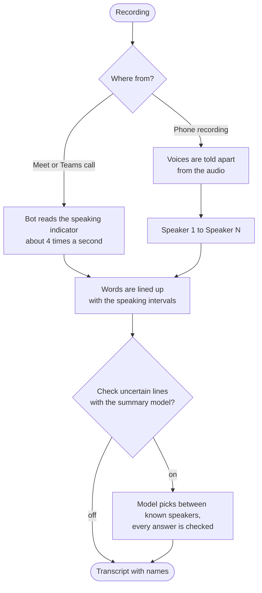
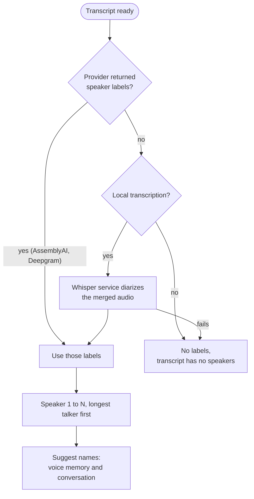

# How speakers are detected

Who said what comes from the call itself. The transcription provider changes the text and word times, not the speakers.

## In a Meet or Teams call

The bot reads the page about four times a second: who is in the call and who has the speaking indicator lit. After transcription the words are lined up with those intervals:

- The indicator lights late, so its measured delay is taken off every interval.
- At a handover, both intervals move to the pause just before it.
- Each word gets the speaker on the cheapest path: staying inside an interval costs less, switching mid-phrase costs more than switching at a pause.
- A sentence goes to the speaker who covers most of it.

Provider labels (Deepgram, AssemblyAI) only break ties. They never override the indicator.

### Lines with two speakers

A transcript line should hold one speaker. The words are cut at every change of speaker, not only when a segment "spans" one:

- **Word level, for every provider with word times** (the local whisper service always has them). Whisper's own segments are only a source of words. They are cut again at each speaker change, at a pause of 2 seconds, and after a sentence once the line is 3.5 seconds long (it used to be 6, see the measurements below). Nothing merges lines afterwards, so two speakers never end up in one line again.
- **Short interjections** of 1 to 3 words ("Waarvoor?", "Ja, oké") become a line of their own when the indicator or diarization shows them apart from the sentence around them.
- **Providers without word times.** A segment is cut by the indicator or diarization intervals alone: only where one speaker is lit by themselves for at least 0.6 s, and each part must hold at least 2 words. The words are placed by characters, so the cut is an estimate. Overlap and flicker never split a line (`splitAtChanges` in `packages/core/src/speaker-split.ts`, constants `SPLIT_MIN_PART_MS`, `SPLIT_MIN_PART_WORDS`, `SPLIT_LAG_TOLERANCE_MS`).
- Existing meetings are not changed. For a line that is already saved, use **Split line** in the [review](voices.md#lines-with-two-speakers).

The whisper service uses faster-whisper with its default voice activity detection (chunks cut at 2 s of silence, 0.4 s padding). Shorter chunks (500 ms silence, 200 ms padding) were measured and gave no gain in single-speaker lines, so they were not adopted.

## Second pass: the context AI

With a summary provider set, uncertain lines are checked once more. Turn it off under Settings, Summaries, Speaker names (`speakers.refine`, on by default).

| Question           | Answer                                                                                     |
| ------------------ | ------------------------------------------------------------------------------------------ |
| What is sent       | About 10 uncertain lines plus 4 lines of context each side: names and text only            |
| What is never sent | Audio, emails, voice prints                                                                |
| What comes back    | Only `{"changes":[{"index","speaker"}]}`, so words and timing cannot change                |
| Bad answer         | The batch is skipped (unknown name, line twice, over 60% changed); the meeting never fails |
| Cost               | About 4 small requests for a 45 minute recording with 40 uncertain lines                   |
| Undo               | Nothing is changed. A different speaker is stored as a suggestion on the line              |

The model may only name a speaker the audio scored at 20% or more for that line, and the prompt tells it to keep the label unless the conversation clearly contradicts it. A suggestion shows under the line with **Accept** and **Reject**. Accept sets the speaker as your own correction. Reject remembers the choice, so the same speaker is not suggested for that line again. Lines you set yourself are never sent or suggested.

Without a summary provider, a plain heuristic runs instead and sends nothing. It only fixes the obvious case: a line that opens like an answer ("Yes", "Ja", "Nee") right after a question. The check can be rerun with job `meeting.review-speakers`.

## How speakers are decided

| Source         | Where it comes from                                                          |
| -------------- | ---------------------------------------------------------------------------- |
| `indicator`    | Meet and Teams speaking indicator                                            |
| `diarization`  | Voices found in a phone recording                                            |
| `ai` / `guess` | Older lines the second pass or a heuristic changed. New reviews only suggest |
| `user`         | A person changed the line. Never overwritten                                 |

With "Check lines against saved voices" on, a Meet or Teams line is also compared with the voices of that meeting (built from each person's cleanest lines, nothing saved), which firms up clear labels and flags lines that sound like someone else, even when nobody has a saved voice. See [Voices](voices.md#voices-of-this-meeting).

If one participant looks like several people (a meeting room), a notice offers to name each voice. Nothing is relabelled until you do, see [Several people in one tile](voices.md#several-people-in-one-tile).

Every line gets a confidence from 0 to 1. It is a heuristic, not a probability. Lines under 70% show as uncertain. Very short lines and turn-taking oddities (a question and an answer from the same speaker, "Thanks, Anna" said by Anna) are capped so they stay uncertain.

Corrections survive re-processing: they are remembered by name and time range and applied to the new lines (best effort). With "Learn voices" on, a correction also teaches that voice. See [Voices](voices.md).

## Phone recordings

There is no indicator, so the voices come from the audio. The first source that gives labels wins.

- Audio never goes to a third party for speaker detection. The diarizer runs only with the local provider.
- "How many people are talking?" on the Record screen takes Auto, 2, 3, 4 or 5+. Use a count only when certain: a count of 2 on a one voice recording invents a second speaker. On a finished recording use Re-run, see [fixing the number of people](#fixing-the-number-of-people). Imports ask the same question before they start, see [import](import-fireflies.md).
- Names are only ever suggested, never applied. A suggestion comes from voice memory (with learning on, up to 3 matches) or from names spoken in the call ("Thanks, Anna", text only). See [Voices](voices.md).
- After transcription, a **Check the people** card on the meeting says how many people were found and who they probably are, from voice memory, the calendar and earlier meetings. Nothing is applied until you confirm. See [Check the people](voices.md#check-the-people).
- A phone recording gets a short title (6 words at most) from its summary. Calendar and link meetings are never retitled.
- Re-transcribing rebuilds speakers, keeps corrected lines and matches new voices to names you gave before.
- Meet and Teams calls are not diarized: the speaking indicator decides, so the number of people does not apply to them.

Models and accuracy

- Local diarizer: sherpa-onnx with pyannote segmentation 3.0 and 3D-Speaker ERes2Net voice prints, on CPU, no account. About 0.5 s CPU per second of audio. Details in `services/whisper/README.md`.
- Models download on first use and are not bundled. Check their licences against your use: some training data has research-only terms.
- Clustering threshold 0.9. Short turns under about 2 s are the weak spot.

| Test set                      | Speaker error rate |
| ----------------------------- | ------------------ |
| Synthetic phone conversations | 8.0%               |
| Five real AMI meetings        | 17.2%              |

Synthetic voices are cleaner than phone audio, so expect worse on real calls. The indicator alignment scores 98.8% of sentences on a synthetic late-indicator meeting and 19 of 19 on a recorded Teams meeting (`e2e/transcripts/run.sh`).

Lines that hold two speakers were measured on 10 real recorded two and three person calls (about 3,200 lines) against hand-checked speaker turns, counting a line as mixed when a second speaker covers it for more than 0.5 s. Before and after the 3.5 s cut:

| Speaker source                 | Mixed lines before | Mixed lines after | Right majority speaker |
| ------------------------------ | ------------------ | ----------------- | ---------------------- |
| Diarization (phone recordings) | 4.0%               | 3.5%              | 89.3% to 90.0%         |
| Simulated speaking indicator   | 2.8%               | 2.4%              | 96.2% to 96.3%         |
| Exact turns (upper bound)      | 2.1%               | 1.9%              | 96.9% to 97.2%         |

The share was already under 5% and the change lowers it by about a tenth. What is left comes from the sources, not the cutting: diarization turns that start or end up to a second off, and replies of 1 to 3 words that whisper drops or glues to the next sentence. Only about 28% of the short replies in the test calls come out as a line of their own with diarization, 37% with the indicator. Such lines are caught in the [review](voices.md#lines-with-two-speakers).

## Fixing the number of people

Diarization sometimes splits one person in several voices (a two person call that shows nine speakers). Tell it how many people speak and it finds exactly that many voices.

Every transcribed meeting has a **Re-run** menu on its page, owner only. Each action asks for confirmation and says what is kept and what changes. The meeting shows its progress while it runs, and it never starts a summary by itself.

| Action                                  | What it does                                                                                                                                                                                                                                                           | Kept                                                                 |
| --------------------------------------- | ---------------------------------------------------------------------------------------------------------------------------------------------------------------------------------------------------------------------------------------------------------------------- | -------------------------------------------------------------------- |
| Re-transcribe                           | Transcribes the recording again with a language (Auto or chosen) and a number of people (Auto or 2 to 5), then the full chain: speakers, voice check, name suggestions, speaker review, and a new summary version                                                      | Lines you set by hand, names of voices where the voice still matches |
| Re-run voice recognition                | Compares every line with the saved voices again, then name suggestions and the speaker review. No transcription, no diarization. Needs "Check lines against saved voices" to be on and says so when it is off                                                          | Text, speakers, lines you set by hand                                |
| Re-run speakers with a number of people | Finds the voices again with exactly that many people (phone recordings and imports), moves the lines to them, then runs the voice check, name suggestions and the speaker review as jobs (`meeting.rerun-speakers`, `meeting.check-voices`, `meeting.review-speakers`) | Text, lines you set by hand, named voices                            |

Re-running speakers relabels the lines by overlap with the new voices. A line you set (`speakerSource: 'user'`) keeps its speaker: when that speaker was named the line follows the voice with that name, and a speaker only such lines still use is not removed. A count of 2 on a one voice recording invents a second speaker, so use it only when sure. If the voices cannot be found, nothing changes and the meeting shows why.

Re-transcribing and the two other actions mark the speakers as changed, so a meeting with a summary shows the notice described under [limits](#limits). Nothing is regenerated by itself.

## Limits

> [!WARNING]
> The reading depends on Meet's page structure, which Google changes without notice. If the page cannot be read, the bot keeps recording and the transcript has no names.

- People are identified by display name: two people with the same name count as one.
- Only people shown in the call grid are seen, so very large meetings can miss some.
- A one-word reply over before its tile lights up can go to the previous speaker. Overlapping speech is only partly recoverable.
- Selectors live in `packages/platforms/src/meet-dom.ts`.

When you change who said a line after a summary was written, the meeting shows a quiet notice above the summary: speakers changed since it was written. **Regenerate summary** makes a new version with your own API key and keeps the old one in History, **Dismiss** hides the notice until the next change. Nothing is regenerated by itself. Changes made by the AI review do not show it. Re-running speakers, voice recognition or the transcription does. Turning down a suggestion on a line counts as a change, because a pending suggestion makes the summary treat that line as a guess (see [summaries](summaries.md#uncertain-speakers)).
