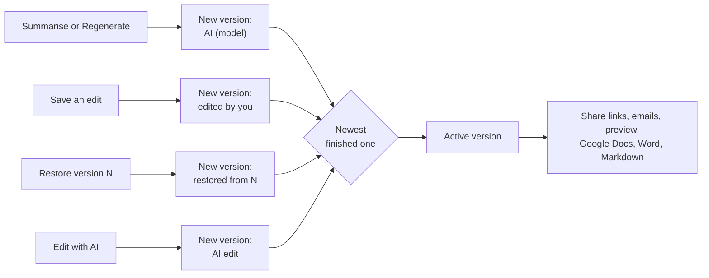
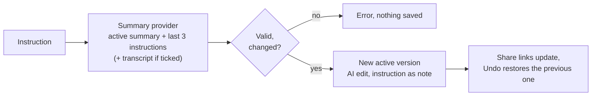

# Summary versions and AI edit

Edit the title, summary and action items table on the meeting page, before or after sharing. Share links are read-only. The minutes always use the active summary version, see [minutes](minutes.md).

## Summary versions

Every summary is a numbered **version**, listed under **History** on the Summary tab.

- Saving adds a version, never overwrites. Restore adds a copy of the old version as the newest.
- Exactly one version is **active**: the newest finished one. Everything above uses it.
- A share link is live. A Google Doc or Word file is a copy: press **Update** on its row (or Share again).
- Regenerate asks first. After AI edits you can pick **Regenerate and re-apply my edits**: your earlier AI instructions are replayed on the fresh summary, one version each. Manual edits cannot be replayed and stay in History. **Undo** restores the previous version.
- Editing and restoring pause while a summary generates.

## Edit with AI

The Summary tab has a collapsed **Edit with AI** bar under the summary. Type an instruction ("remove all open questions, they were clear") or pick a chip, and the AI rewrites the active summary. The same box can also fix the people: "remove Dennis from unable to attend, he was there as Dennis K" dismisses that invitee or marks them as present under the matching attendee.

- It uses your configured summary provider and model, shown under the box. Each instruction is one request, billed by that provider. Without a provider the bar is replaced by a hint.
- It uses your configured summary provider, one billed request per instruction. Without a provider the bar shows a hint.
- When the meeting has invitees under **Unable to attend**, a first request lets the model pick invitees to remove or to mark as present. It can only choose from the people listed on the page, nothing else is accepted. If only the people changed, no summary version is written.
- The model returns the full Markdown and invents nothing. **Use the transcript too** (off by default) lets it add or check facts.
- Limits: 1000 characters per instruction, 20 edits per meeting per 10 minutes, one at a time. Nothing is saved when the provider fails or the result is empty or unchanged. A result under 15 percent of the original asks for confirmation.
- The last instructions are listed with **Show changes** and **Undo**. Google Docs, Word files and sent emails are copies: use **Update the Google Doc** after an edit.

API: `POST /api/meetings/:id/summary/ai-edit` with `{ "instruction": "...", "useTranscript": false }`, returns `201 { summaryId, previousId, people }`. `summaryId` is left out when only the people lists changed, `people` lists what changed in words. Add `"confirmShrink": true` to accept a result that removes almost everything.
