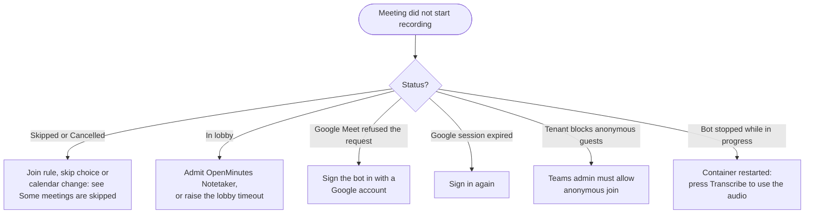

# Troubleshooting

The meeting status shows why a join or job failed. Start there, then check the containers:

```bash
docker compose ps
docker compose logs --tail 100 web worker bot
```

Include these logs (without keys) in an issue.

## The page does not load or I cannot sign in

- `web` should be healthy in `docker compose ps`. If it restarts in a loop, `docker compose logs web` names the cause, such as a missing `OPENMINUTES_SECRET` or "The database was migrated by a newer version" (see [upgrading](upgrading.md)).
- Behind Cloudflare Access a 401 means the AUD tag or team domain is wrong, see [reverse proxy](reverse-proxy.md#cloudflare-access-sign-in-by-cloudflare).
- Lost admin password: there is no reset page. Delete the stored hash and the first-run password step returns: `docker compose exec db psql -U openminutes -c "delete from settings where key = 'admin.password_hash'"`

## The bot does not join



| Status                                             | Fix                                                                                                                                                                           |
| -------------------------------------------------- | ----------------------------------------------------------------------------------------------------------------------------------------------------------------------------- |
| Waiting in the lobby                               | The host admits OpenMinutes Notetaker, or raise the lobby timeout (default 10 minutes) under Settings, General, Meeting limits, see [meeting lifecycle](meeting-lifecycle.md) |
| Google Meet refused the request                    | Sign the bot in to a dedicated Google account, see below                                                                                                                      |
| The Google session of the bot expired              | Import a new session, see [Meet sign-in](meet-sign-in.md)                                                                                                                     |
| This tenant blocks anonymous guests (Teams)        | The tenant must allow anonymous users, no workaround, see [Teams](teams.md)                                                                                                   |
| The bot stopped while this meeting was in progress | The bot container restarted. Audio is kept: press Transcribe                                                                                                                  |

## The status says "Google Meet refused the request to join"

Meet showed "You can't join this video call" right after the bot pressed Ask to join. Google judges the environment, not the meeting: guest joins from servers get a 403. Fix: sign the bot in to a dedicated Google account, see [Signing the Meet bot in](meet-sign-in.md). Teams is not affected.

## Some meetings are skipped

Check the calendar's join rule: it may be set to only meetings you organise, or only with external guests. Skipped meetings are not in the Recent list by default: tick Skipped in its Status menu to see them.

## Speakers are wrong or missing

Speakers are read from the Meet and Teams pages, which change often. Transcripts still work, without names. Update to the newest version and open an issue with the platform and date.

## Sign-in to Google or Microsoft fails

| Error                                                         | Fix                                                                                                                         |
| ------------------------------------------------------------- | --------------------------------------------------------------------------------------------------------------------------- |
| `redirect_uri_mismatch` (Google) or `AADSTS50011` (Microsoft) | The redirect URI must match the one under Settings, Calendar accounts exactly. Behind a proxy, set `OPENMINUTES_PUBLIC_URL` |
| Google access stops after a week                              | The consent screen is in Testing. Set it to In production, see [Google guide](google-oauth.md)                              |
| Microsoft sync stopped months after setup                     | The client secret expired. Create a new one, see [Azure guide](azure-app.md)                                                |

## Transcription or summary fails

Press Test next to the provider in Settings: it catches wrong keys, missing models and unreachable base URLs.

- Local provider: check the whisper service runs (`docker compose --profile local up -d`).
- A failed transcription shows its error on the meeting page: Re-run transcription. A failed summary: Regenerate.
- A size message on a long meeting: raise `maxInputChars` or use a larger-context model.
- Stuck on Transcribing: the page shows the step and percentage. Cancel stops it, Retry restarts it. A run silent for 10 minutes is marked failed.

## The transcript is wrong

- "No speech was detected" for a recording with speech: a cloud model locked onto one made-up line. OpenMinutes redoes it with the local service; this message means that failed too. Start the service and re-run.
- Garbled text in the wrong language: pick the language yourself with Re-run in <language> on the meeting page.

## Other

- Out of memory: lower Parallel meetings under Settings, General, Meeting limits, see [sizing](sizing.md).
- Too many failed attempts: wait, or restart the web container, see [configuration](configuration.md#sign-in-protection).
- Camera image or join message missing: both are best effort. The bot logs `camera image could not be prepared` or `join message could not be sent`. The meeting is still recorded.
