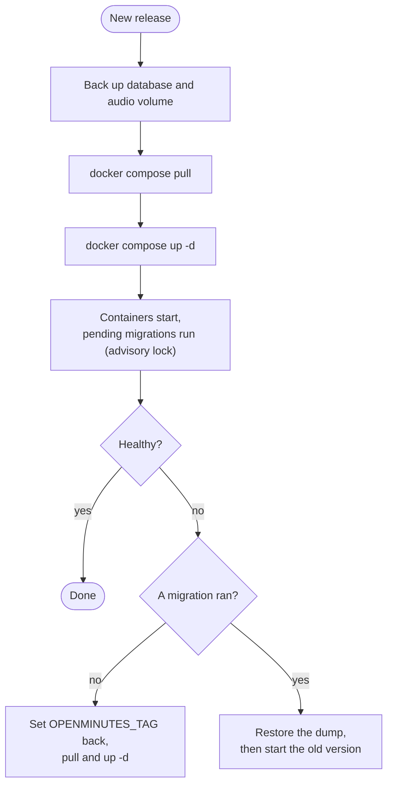

# Upgrading and backups

Time: 2 minutes to update, 5 minutes for a backup. Short version: [UPGRADING.md](../UPGRADING.md).

## Update



```bash
docker compose pull
docker compose up -d
```

> [!TIP]
> Back up first, see below. It is the only way back once a migration has run.

Read the [release notes](https://github.com/dennisklappe/openminutes/releases) before a minor update, especially before 1.0.

## Pick a release line

The compose file reads `OPENMINUTES_TAG` from `.env` (default `0.1`):

| You set                 | You follow                                                                |
| ----------------------- | ------------------------------------------------------------------------- |
| `OPENMINUTES_TAG=0.1`   | Every `0.1.x` patch release. Moving to `0.2` is your decision.            |
| `OPENMINUTES_TAG=1`     | Every `1.x.y` release, once 1.0 is out. Breaking changes only come in 2.0 |
| `OPENMINUTES_TAG=0.1.3` | Exactly that release, until you edit the line.                            |

Avoid `latest`. The tag applies to all four images (web, worker, bot, whisper): run them at one version.

## Back up first

Back up before every minor update and anything you are unsure about:

```bash
docker compose exec -T db pg_dump -U openminutes -Fc openminutes > openminutes-$(date +%F).dump
docker compose run --rm --no-deps --user root -v "$PWD:/backup" --entrypoint tar web czf /backup/openminutes-data-$(date +%F).tgz -C /data .
```

The first is the database, the second the audio volume. Keep `OPENMINUTES_SECRET` with them: without it stored keys and tokens cannot be decrypted.

Restore the database (replaces what is there):

```bash
docker compose stop web worker bot
docker compose exec -T db dropdb -U openminutes --if-exists openminutes
docker compose exec -T db createdb -U openminutes openminutes
docker compose exec -T db pg_restore -U openminutes -d openminutes < openminutes-2026-01-01.dump
```

## Migrations and rolling back

Web and worker apply pending migrations on start (a Postgres advisory lock lets one container apply). Migrations only go forward. If the database is newer than the app, the containers refuse to start ("The database was migrated by a newer version of OpenMinutes") and restart in a loop. The database is untouched.

| Update           | Roll back                                                                                                        |
| ---------------- | ---------------------------------------------------------------------------------------------------------------- |
| No migration ran | Set `OPENMINUTES_TAG` back, then `docker compose pull && docker compose up -d`                                   |
| A migration ran  | Restore the dump taken before the update, then start the old version. Anything recorded after the backup is lost |

Without a backup, move forward to the next fixed release instead.

## Automatic updates

Not by default. An opt-in [Watchtower](https://github.com/nicholas-fedor/watchtower) override checks daily and touches only OpenMinutes-labelled containers:

```bash
docker compose -f compose.yaml -f compose.watchtower.yaml up -d
```

It stays inside your `OPENMINUTES_TAG` line (with `0.1`, patch releases only) and takes no backups.

## Update notice

Off by default (Settings, Access and updates). When on, the server (not your browser) asks GitHub for the latest release at most once per 24 hours, with no body, cookies or identifiers. GitHub sees your server's IP. A newer release shows a dismissible banner. A failed check blocks nothing. Switched off, no request is made. There is no telemetry.

## Version

The running version is at the bottom of every page and at `/api/version`.
