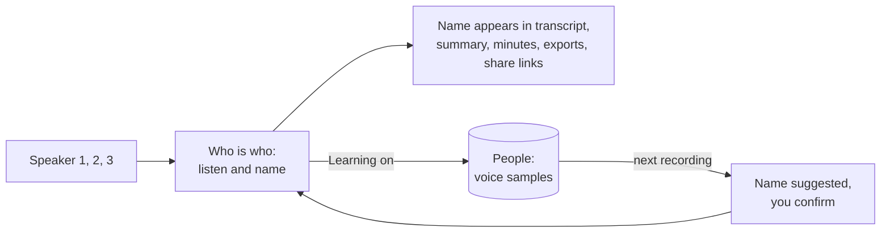

# Voices and speaker names

Phone recordings have no speaking indicator, so voices start as Speaker 1, Speaker 2 and so on. In the **Who is who** panel on the meeting page, listen to a few words of each voice and name it.

Giving two voices the same name merges them, which fixes one person split in two.

## People

Everyone you name, invite or add by hand is listed under **People**. A person has a name, none, one or several emails, and optional notes. People appear when you name a speaker, rename a participant or add one yourself. You can edit a person, merge two people (emails, voice samples and meetings move to the one you keep) and delete one. Renaming a person also renames their label in every meeting. The text of summaries and minutes is not rewritten.

Open a person to see:

- the **voice profile**: how many verified samples it holds, how many seconds of clean speech they cover and how many ways of sounding (up to 5 vectors) are kept
- **Needs review**: lines labelled as this person or suggested for them that are uncertain, plus lines the voice check doubts
- **Verified lines**: lines you confirmed as this person

Each line can be played. **Verify** says the line is this person, sets the label as a correction of yours and, when learning is on, adds its voice to the profile. **Not this person** takes the line away and gives it to the next best speaker, and it is not offered to this person again. **Move to...** gives it to someone else. **Remove from profile** keeps the label but forgets the voice sample.

## Voice settings

Two options under Settings, Summaries, Voices. Both are off by default because a voiceprint is biometric data.

| Option                           | What it does                                                                                                                                                |
| -------------------------------- | ----------------------------------------------------------------------------------------------------------------------------------------------------------- |
| Learn voices from lines I verify | Lines you name, assign or verify add a voice sample to the person. Names you give in phone recordings are remembered, so the voice is suggested next time.  |
| Check lines against saved voices | Meet and Teams lines are compared with the saved voices of the people in the meeting. Lines that sound like someone else are flagged and show under People. |

Without learning, verifying a line only confirms who said it. Without a saved voice nothing is checked and nothing changes.

| Question            | Answer                                                                                                                              |
| ------------------- | ----------------------------------------------------------------------------------------------------------------------------------- |
| What is stored      | A list of numbers per verified line (a voice sample), the people and a profile of up to 5 vectors built from the samples. No audio. |
| Where               | Your own database, tables `people` and `voice_samples`. Never sent to another service, never returned by the API.                   |
| What it is used for | Suggesting a name next to a voice, and flagging lines that sound like someone else. You always decide.                              |
| Matching            | A new voice is compared with every vector of a person and scores as the best of them, not as an average.                            |

## The voice check

For meetings whose speakers come from the speaking indicator, and only when someone in the meeting has a saved voice:

1. Each line is embedded on its own by the whisper service (`POST /embed-lines`). A line under half a second is read from a one second window around it.
2. The voice is compared with the saved voices of the meeting's participants.
3. The timing score of the line is combined with how well its own voice fits against the best other voice. The voice can lower the confidence by half at the most. Its weight grows with the length of the line, reaching full at 2.5 seconds, because a voice print of a few words cannot tell people apart.
4. A line of at least a second is **doubted** when another saved voice fits clearly better than the labelled one, or the labelled voice fits very badly. A doubted line stays uncertain, gets the better fitting speaker as a suggestion and shows under People, Needs review.

The labels are never changed by the check. Lines you set yourself are skipped. The check runs when a meeting is transcribed, not when only the speaker check is rerun.

## Deleting

Delete the voice data of one person on their page, or of everyone under Settings, Summaries, Voices. People, names and emails stay. Turning an option off stops learning or checking and keeps what is saved.

> [!NOTE]
> Deleting a meeting removes its speakers' voiceprints from the meeting, not the saved voices. Delete those separately.

## Dutch and other languages

The default embedding model (3D-Speaker ERes2Net, trained on English VoxCeleb) works on Dutch speech but was not tuned for it. The model is read from the environment of the whisper service, so a multilingual model can be tried without a code change: set `DIARIZATION_EMBEDDING_NAME`, `DIARIZATION_EMBEDDING_URL` and `DIARIZATION_EMBEDDING_SHA256`. Voice prints of two models cannot be compared. After a change, delete the voice data and verify lines again. The model name is kept with every sample.

## Privacy

> [!WARNING]
> A voiceprint can identify a person, so treat it as personal data. Tell people you record that their voice may be remembered, and delete voices on request. This is not legal advice. See the [consent and legal notes](consent-and-legal.md).
