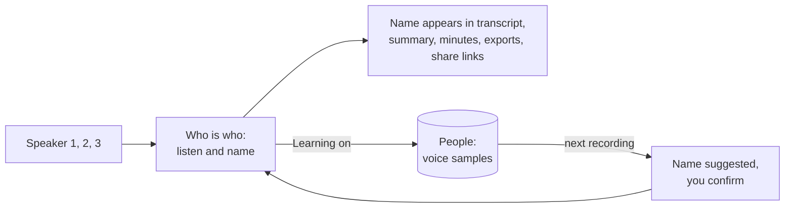
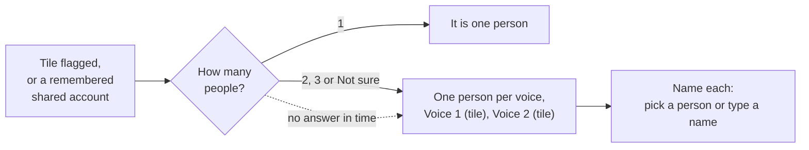

# Voices and speaker names

Phone recordings have no speaking indicator, so voices start as Speaker 1, Speaker 2 and so on. In the **Who is who** panel on the meeting page, listen to a few lines of each voice (each has a play button) and name it.

Giving two voices the same name merges them, which fixes one person split in two.

## People

Everyone you name, invite or add by hand is listed under **People**. A person has a name, none, one or several emails, and optional notes. People appear when you name a speaker, rename a participant or add one yourself. You can edit a person, merge two people and delete one. To merge, use **Merge into another person** on the person page, or tick two people in the list and choose **Merge 2 selected**. You pick which name to keep and the dialog lists what moves over (emails, voice samples, meetings, rename rules and invitations) before anything happens. The person you do not keep is removed. People who look like doubles, for example the same email, or "Dennis" and "Dennis Klappe" on the same company domain, show a **Possible duplicate** hint with a Merge button. Nobody is merged automatically. Renaming a person also renames their label in every meeting. The text of summaries and minutes is not rewritten.

Open a person to see:

- a **voice profile card per language**: one person, one name and one set of emails, but a separate profile for each language they speak, because most people sound different in Dutch than in English. Each card shows the language, two [readiness bars](#when-a-voice-profile-is-ready) (**Length** and **Variety**), the sample count, a **Delete this profile** button and the verified lines in that language. A card appears by itself the first time a line in that language is verified. The profile keeps one vector per [way of sounding](#ways-of-sounding)
- the **People list** shows a small chip per language next to the profile status
- **Needs review**: how many lines the review queue would ask about for this person, not every unsure line: the doubtful ones plus only as many confident lines as the voice profile still needs to become ready. Lines under 3 seconds, overlapped lines, filler and skipped lines never count. The same number shows in the People list (**To review**) and above the Review button
- **Verified lines**: lines you confirmed as this person

Each line can be played. **Verify** says the line is this person, sets the label as a correction of yours and, when learning is on, adds its voice to the profile. **Not this person** takes the line away and gives it to the next best speaker, and it is not offered to this person again. **Move to...** gives it to someone else. **Remove from profile** keeps the label but forgets the voice sample.

## Reviewing speakers

**Review** on the People page goes through a short queue of lines worth a look, all people mixed. The button shows how many it asks in one session (at most 25), as `25 of 140 lines` when more are waiting. Scope the same flow to one person (**Review** on their page) or one meeting (**Review speakers** in the meeting menu, also in the row menu of the meetings list). A chip shows the scope, its cross goes back to everyone.

A line enters the queue for one of two reasons, and the card says which:

- **Not sure who this is** (real doubt): the labelling is under 70% sure, the voice check disagrees, a close competing candidate scores 50% or more, the speaker review suggests someone else, or the line was labelled by elimination. This does not depend on how good the profile is, so a doubtful line of a well-profiled person is still reviewed.
- **Needs more samples** (training need): the label looks right, but the profile of that person in that language is not [ready](#when-a-voice-profile-is-ready) yet. Confirming the line adds to the profile. Once the profile is ready these lines disappear, and the queue shrinks a lot. A ready person is still asked about a line their voice disagrees with: a line that scores under their agree score (0.6 by default) is shown as **Not sure who this is** with the reason that the voice does not fit.

Only lines that can teach a voice are asked: at least 3 seconds, nobody talking over them and not mostly filler ("yeah", "okay"). Within the queue, [environment cards](#new-environment-cards) come first, then doubtful lines, then the people with the least verified speech, and the picks are spread over different meetings, moments far apart and sources instead of near duplicates. A session holds 25 cards, environment cards included. At the end, **Keep going** loads the next 25. The card shows a coverage meter such as "Dennis: 45 s of 120 s, Dutch", and the end screen lists the profiles that are ready. The order switch (**Newest meetings first** or **Least sure first**) sorts the cards inside the session.

**Skip** is remembered: a skipped line does not come back after a refresh or in another session. It returns when you press **Review N skipped** at the end, or when the line is proposed for someone else. Approve, Disapprove, Skip, Split and Mixed are saved the moment you press them, and **Undo** takes the last one back on the server too (the old label, the voice sample, the skip, the split or the mixed mark).

### When a voice profile is ready

A profile (one person, one language) has two bars on its card:

- **Length**: clean speech in the profile against a target of 120 s. Lines you confirmed count in full, automatic samples at 0.4
- **Variety**: the weaker of two shares, the meetings the samples come from against 5, and the [ways of sounding](#ways-of-sounding) against 5. Samples without a meeting (imported voices) count together as one meeting

The profile is **ready** when both bars are at 100%. A ready person stops generating review cards for lines their voice agrees with, and is never exempted from lines it disagrees with (see above). The targets are settings (see [Voice settings](#voice-settings)): they are starting values and can be tuned without a release.

### Ways of sounding

A person sounds different on a headset, in a car or in a meeting room. The profile keeps one vector per way of sounding, with no fixed number:

- a new confirmed sample joins the closest vector when their cosine similarity is at least the **merge similarity** (0.6 by default) and moves its running mean (weighted by how many samples it stands for), else it starts a new vector
- a vector made of one or two samples that no line matched for 120 days, or that only attracted lines you turned down, is **pruned**: its samples stay as lines but leave the profile. Each vector keeps a few counts for this (when it appeared, when a line last matched it, how many lines matched it or were turned down after matching it). A vector from before this feature gets its 120 days from the first rebuild
- there is a hidden safety ceiling of 30 vectors per person per language: beyond it the two closest vectors are merged
- a voice is scored by the closest vector (the highest cosine), then goes through the relative and elimination scoring of the [voice check](#the-voice-check)

Removing a sample builds the profile again from the remaining ones, so the result depends only on the samples.

### New environment cards

When the voice labelled as a person in a meeting does not match that person's profile for most of the meeting, the review gets one card for that voice in that meeting, even when the person is ready: "This voice is labelled Jo Parker but does not match their profile. Is it them?". It is created when the meeting is transcribed with the voice check on, for a voice with at least 30 s and 5 lines of speech (lines of 2.5 s or more) of which 60% or more of the speech scored under the agree score of the person. Shared tiles, people marked do not track and lines marked mixed never make a card, and a voice is asked once per meeting, also after an answer.

The card shows a few of the clearest lines to play and the share that did not match. It ranks before every line in the queue and counts towards the 25 of a session.

- **Yes, it is them** (**A**): the whole voice is theirs in this meeting. The lines on the card become verified lines and are learned as a new way of sounding (when Learn voices is on), and the doubts on the other lines of that voice are settled
- **No, someone else** (**D**): it is someone else on that account. You pick the right person, the lines of the voice move to them as verified lines, and nothing enters the profile of the person it was labelled as
- **Skip** (**S**) is remembered like a skipped line and comes back under **Review N skipped**, **Undo** (**U**) takes a skip back. A confirmed or moved card cannot be undone from the card, move the lines again from the person page

Every card has its own address, `#/people/review/voice/<id>`.

### Lines with two speakers

A line sometimes holds two people, for example "Waarvoor?" by one and the answer by another. Approving it would teach a voice with someone else's speech, and skipping it leaves a wrong label that comes back. Two actions on the card deal with it (keys on the buttons: **S** skip, **D** disapprove, **A** approve, **X** split, **M** mixed, **U** undo):

- **Split line** (**X**): the words of the line show as chips. Click the word where the second speaker starts, **Split again** adds a second cut for three parts, and each part gets a person: the proposed person for the first part, and for the others a picker with the other people of that meeting (the same list as Disapprove). Times are estimated from the characters, since lines store no word times. The parts become decided lines, verified for their person, and the ones of 3 seconds or more feed the profiles through the normal guarded path. Shorter parts are only labelled. **Undo** puts the original line back, but cannot bring back a voice sample the original line had.
- **Mixed, skip for training** (**M**): the line keeps its label, is never used for a voice sample (a sample it already has is removed), and never shows up in a review queue or count again. In the transcript it carries a small **mixed** marker with a **Clear** button, and **Undo** takes it back.

A third source is automatic. Before a line of 4 seconds or more becomes a voice sample, by verifying it or as an automatic sample, its first and second half are embedded and compared. When they sound clearly unlike each other (cosine under 0.3) the line is marked **probably mixed**: it trains nothing, and it is asked about with the reason **Probably two speakers** and the split already open. Approving or moving such a line yourself clears the mark, and then it does train. The guard is a tripwire, not a detector: on real recorded Dutch calls with the default embedding model, two halves of one speaker had a median cosine of only 0.59, so at 0.3 about 8% of single speaker lines are flagged and about 39% of lines across a speaker change are caught. A guard that cannot run (no voice service) lets learning go on as before. Cost: two voice prints per long candidate line, none for shorter lines, and automatic samples only check lines that already passed every other test.

Every card has its own address, `#/people/review/<line>` or `#/people/<person>/review/<line>`, with the scope and order in the address. A refresh opens the same card and the link can be bookmarked or shared. The address replaces the previous one as you move on, so Back leaves the review instead of walking through decided lines. If the line is no longer in the queue, a notice says so and the next card opens.

## Do not track

Choose **Do not track** on the person page, the People row menu or the review card for someone whose voice must never be kept. After you confirm:

- their voice samples, voice profile and the voice saved on their meeting participants are deleted
- no voice is learned for them, also not from lines you verify or move to them, and not from the **Not X, unsure who** answer
- they are not suggested anywhere: not as the proposed speaker on a review card, in the lists of other lines, in the speaker review, in the voice check, in name suggestions for unknown voices, or as a person created by the scan of your meetings
- their lines are never offered for review

They stay by name in transcripts and minutes. **Someone else...** in the review lists them as not tracked, and the People list can show them with the Tracking filter. **Track again** on their page undoes it, the voice then starts from nothing. Merging a person who is not tracked into someone keeps the result not tracked and without voice samples.

## Voice settings

Two options under Settings, Summaries, Voices. Both are off by default because a voiceprint is biometric data.

| Option                           | What it does                                                                                                                                                                                                                                 |
| -------------------------------- | -------------------------------------------------------------------------------------------------------------------------------------------------------------------------------------------------------------------------------------------- |
| Learn voices                     | Lines you name, assign or verify add a voice sample to the person, in the language of the line. Names you give in phone recordings are remembered, so the voice is suggested next time. Also allows [automatic samples](#automatic-samples). |
| Check lines against saved voices | Meet and Teams lines are compared with the saved voices of the people in the meeting and with the voices heard in that meeting. Lines that sound like someone else are flagged and show under People.                                        |

Without learning, verifying a line only confirms who said it. Without a saved voice nothing is checked and nothing changes.

Under **Readiness and matching** on the same page are five numbers. Each has a default and a **Reset to defaults** button:

| Setting                                     | Default | Range       | What it does                                                                                                                                |
| ------------------------------------------- | ------- | ----------- | ------------------------------------------------------------------------------------------------------------------------------------------- |
| Seconds of clean speech for a ready profile | 120     | 10 to 3600  | Fills the Length bar                                                                                                                        |
| Meetings for a ready profile                | 5       | 1 to 50     | Fills the Variety bar together with the ways of sounding                                                                                    |
| Ways of sounding for a ready profile        | 5       | 1 to 30     | Fills the Variety bar together with the meetings                                                                                            |
| Score at which a voice agrees               | 0.6     | 0.2 to 0.95 | A line scoring at least this against a profile sounds like the person. A person whose automatic samples were rejected needs up to 0.15 more |
| Similarity at which a sample joins a way    | 0.6     | 0.2 to 0.95 | Below it a sample starts a new way of sounding. Lower: fewer, broader ways. Higher: more, narrower ones                                     |

The 0.6 comes from the measurements in this repo: a clean turn scores 0.6 to 0.9 and a noisy one 0.1 to 0.4 against its speaker, and two halves of one line of one speaker had a median cosine of 0.59. They are starting values that real audio has not tuned: change them in the settings, not in the code, and compare the scores on the review cards (the voice fit of a line) with what you confirm.

| Question            | Answer                                                                                                                                                                                                                                                                     |
| ------------------- | -------------------------------------------------------------------------------------------------------------------------------------------------------------------------------------------------------------------------------------------------------------------------- |
| What is stored      | A list of numbers per verified line (a voice sample), the people and a profile per language built from the samples (one vector per [way of sounding](#ways-of-sounding)), and a list of numbers per voice found in a [shared tile](#several-people-in-one-tile). No audio. |
| Where               | Your own database, tables `people` and `voice_samples`. Never sent to another service, never returned by the API.                                                                                                                                                          |
| What it is used for | Suggesting a name next to a voice, and flagging lines that sound like someone else. You always decide.                                                                                                                                                                     |
| Matching            | A new voice is compared with every vector of a person and scores as the best of them, not as an average.                                                                                                                                                                   |

## The voice check

For meetings whose speakers come from the speaking indicator, when someone in the meeting has a saved voice or the meeting has clean lines of at least two people to learn from ([voices of this meeting](#voices-of-this-meeting)):

1. Each line is embedded on its own by the whisper service (`POST /embed-lines`). A line under half a second is read from a one second window around it.
2. The voice is compared with the saved voices of the meeting's participants.
3. A line is compared with the voice profile of its own language first. A person with no profile in that language is compared with their other languages, minus a small penalty (0.05). The timing score of the line is combined with how well its own voice fits against the best other voice. The voice can lower the confidence by half at the most. Its weight grows with the length of the line, reaching full at 2.5 seconds, because a voice print of a few words cannot tell people apart.
4. A line of at least a second is **doubted** when another saved voice fits clearly better than the labelled one, or the labelled voice fits very badly. A doubted line stays uncertain, gets the better fitting speaker as a suggestion and shows under People, Needs review.

The check scores the participants against each other, not against a fixed bar:

- a label that leads clearly (score of 70% or more and 30 points ahead of everyone else) gains a little confidence, never full certainty
- a saved voice that is sure of someone else (80% or more) while the line is labelled as another person is a conflict: the line is doubted, the label loses half of its candidate score and the better fitting speaker is suggested
- by elimination: when exactly one participant has no saved voice, nobody is marked do not track, and a line of 2.5 seconds or more fits none of the saved voices (all under 30%), the line is probably that participant. It gains confidence when already labelled so, else that participant is suggested. These lines are marked **By elimination**, always go to review, and are never added to a profile by themselves

### Voices of this meeting

The check also builds a temporary voice per participant from the meeting itself, so it works when nobody has a saved voice, and it can tell two unknown people apart. It uses the same option, **Check lines against saved voices**: with it off nothing is embedded and nothing is compared.

- **Anchor lines** are the cleanest lines of a participant: 3 seconds or more, labelled by the speaking indicator with at least 90% confidence, not changed by you or an AI review, no other line overlapping by more than 0.3 s, and the indicator showing only that person for at least 90% of the line. At most 12 per person, the longest first
- an anchor that does not sound like the person's other anchors (median cosine under 0.4, or under 0.5 to the rest) is dropped, so a label that lagged behind the indicator cannot poison the print. A person needs 2 anchors left to get a meeting voice. Without saved voices at least 2 people need one
- every line is compared with the meeting voices, an anchor line with the others so it does not vouch for itself. A person who also has a saved voice scores 60% saved voice and 40% meeting voice. The line then goes through the same judgement as above, so a line that sounds clearly like someone else is doubted and that person is suggested
- a line of 2.5 seconds or more whose label wins clearly (60% or more and 15 points ahead of the runner-up) is raised to 85% confidence, never to certainty. No label is changed by this check
- meeting voices exist only while the meeting is checked. They are not saved, not shown, and never added to a person's profile. Profiles still learn only from lines you verify and from the guarded [automatic samples](#automatic-samples), which only count the saved voices

The labels are never changed by the check. Lines you set yourself are skipped. Lines marked mixed are never anchors and never learned from. The check runs when a meeting is transcribed, not when only the speaker check is rerun.

## Check the people

After a phone recording or an import is transcribed there is no call roster, so the meeting page shows a **Check the people** card above the transcript, for example "2 people detected: Jo Parker (sure), Ann Lee (probable). Is that right?". It is shown once per meeting, only to you, and never for a Meet or Teams call. It goes away when you confirm or dismiss it, or when every voice already has a confirmed name.

Each voice gets a name from these sources, best first:

- **Saved voices.** The voice of the recording is scored against the voice profile of every tracked person, in the language of the meeting, with the same score the [voice check](#the-voice-check) uses. At least 55% fit is a match. It is **sure** when the fit is 70% or more and leads the next person by 10 points, else **probable**. One person is given to one voice only, the better fit keeps them. Nothing new is matched or trained for this
- **The calendar.** The attendees of the meeting's own invitation (imports), or of the calendar event around the start of the recording (it starts at most 15 minutes after the recording began and at most 2 hours before). You, people who declined and resource calendars are left out. When exactly one voice and exactly one attendee are left after the matching, they are offered as a **probable** pair. With more left, the attendees are only offered as suggestions for a voice without a match. Calendar events without a meeting link are not stored by OpenMinutes, so this works for events that are
- **A name the voice already has**, for instance from an import, is shown as probable.

Each voice shows up to 3 **sample lines** so you can hear who it is: the longest clean lines of that voice (3 to 12 seconds, one speaker, not just filler), spread over the meeting, in meeting order. Each has a play button and the text of the line, and **Show in transcript** jumps the transcript to it. Check the people and [Who is who](#voices-of-this-meeting) use the same voice card and the same sample lines, so a voice looks and plays the same in both: one clip at a time, and a clip stops when you start another or leave the card. When the audio was deleted the lines show as text only. A voice with no clear line says so.

A match reads "Matches Jo Parker (probable)" (or "Invited: ..." and "Already called ..." for the other sources). Under it the card can say "Company: probably Acme". That company is a guess from the work email domain of the person or the attendee (free mail and your own domains are skipped), else from the company most of your earlier meetings with them had. It is only shown, never saved: People have no company field.

Actions:

- **Confirm** sets the names shown as confirmed names, as naming a voice does, and creates a person for a new name. With **Learn voices** on, the lines of each confirmed voice (3 seconds or more, one speaker, not just filler, the 20 longest) are queued for learning, the same job that runs after you verify a line, so the profile of that person grows. Nothing is learned from a voice you did not confirm, from a person marked do not track, or with Learn voices off
- **Change this person** picks someone else: an attendee of the calendar event, anybody in People, or **New person...** with a name and an optional email. A voice without a match shows the attendees as **Invited** chips and a name field. Tapping a chip gives that person to the voice
- **Change number of people** opens the speaker count choices of the meeting (re-process with 2 to 5 speakers). When the voices were split wrongly, change the count first, then check again
- **Dismiss** hides the card without changing anything

## Several people in one tile

A meeting room, or two people in front of one screen, shows up as one participant, so the speaking indicator cannot tell them apart. With **Check lines against saved voices** on, the check looks at the clean lines of each participant (the same lines as the [voices of this meeting](#voices-of-this-meeting), up to 60 per participant) and groups them by voice. A participant whose lines fall into two or more clear groups (each with at least 3 lines and 12 seconds of speech, at most 4 groups) is flagged as probably several people. A group that sounds like another participant of the meeting is ignored, and so are bots and people marked do not track.

### How many people

- the meeting page shows a quiet card, for example "Ann and Sam sounds like several people. How many?", with **1**, **2**, **3** and **Not sure**. 1 says it is one person. **Not sure** takes the number of voices found. A number other than the voices found clusters the lines of that tile again into exactly that many voices (the closest groups join until that many are left, each voice needs at least 2 lines), which runs in the background
- the **summary** waits for the answer. The transcript and everything else go on. Under Settings, Summaries, **Wait for how many people on shared accounts** sets the time (15 minutes by default, 0 never waits). When it runs out the summary goes on with the number of voices found, and the notice that speakers changed since the summary covers a later change. The summary job looks again every 20 seconds through the job queue, it does not hold a worker
- the answer is **remembered per shared account**: its email when it has one, else its normalised name. The next meeting from the same account skips the question and clusters with that number. Under Settings, Summaries, **Remembered shared accounts** lists them with **Remove**, which makes the next meeting ask again and keeps the people already made
- nothing is asked for a tile of one person, and nothing happens for a tile nobody flags and nobody remembered. Where detection missed it, use **Split into 2 people** or **Split into 3 people** on the participant in the People card. This uses the same clustering with a fixed number and the same data
- two voices that follow each other with less than about a second of silence between them can be merged by the transcription into one line, and that line is then given to one voice. Splitting such a line is covered by the Split line feature in the next release

### People under the tile

As soon as the number is known, each voice becomes a **real person** (source joined) called **Voice 1 (Ann and Sam)**, **Voice 2 (Ann and Sam)**, marked **Unnamed**. They are not merged with anybody and not made for a tile of one voice. The same voice number of the same account is the same person in every meeting and after the meeting is processed again with the same number, so naming a voice once names it everywhere.

- in the **People** card of the meeting every voice is a person of the list like everyone else, in the place of the tile, with its speaking time, line count (its own lines only), a few clear lines to play, a small "via <tile>" tag and, once named, a link to their page. The tile is no row: a quiet note under the list says "Joined from one shared account: <tile>, N voices" and opens to **It is one person** (removes them again, as long as none is named), **Split into 2 people** / **Split into 3 people** (shown while none is named) and renaming the account. The note is hidden when the tile has one voice or was dismissed. An unnamed voice has a **Name** button
- a person who also joined by themselves keeps their own participant row and is never merged into the voice row. The voice sits right under them with its own lines and time, and a hint "Same person as the participant above. Wrong? Change who this is". When the participant has no lines other than the voice's (the seat only exists for the voice) it is one row. The transcript legend, talk time, minutes and share page already list seats and voices flat
- an invitee belongs to one person of a meeting: linking it to someone else (rename, **They were there**, a person from People) answers 409 naming who has it, or moves it with `move` so it leaves the previous person
- **Name** on a person (also on the People tab and the person page) opens "Who is this?": someone from the meeting, from People, or a new name. A new name keeps the person and all their meetings. Picking someone who exists moves the voice, its lines, voice samples and meetings to them and removes the placeholder. Nothing is ever merged by itself
- the transcript, the speakers filter and the talk time list each person as their own speaker, with the small "via Ann and Sam" note and a colour of their own, also while still unnamed. Lines that overlap someone, are shorter than 1.5 seconds or fit no voice clearly (0.5 or more, 0.1 ahead of the second voice) stay with the tile and become uncertain, so they show up in review. Lines you set yourself are never taken over
- on the **People** tab they are normal people with the **Unnamed** tag and a small "via shared account" tag. The **Unnamed voices** filter lists only them, and a person's lines show the same tag. Each has a voice profile of their own, built only from lines assigned to their voice
- **Name them** (the naming page of a tile) lists the voices with a few lines to listen to and does the same as **Name**

### Naming with emails, and changing who a voice is

**Name** is two steps in one dialog: pick a person (someone from the meeting, from People, or a new name), then optionally the emails. The emails step lists every invitee of the meeting, also the ones under "Unable to attend", plus a field for another address, and shows the addresses the picked person has already. An invitee that someone else has says "taken by X, tick to move it here": ticking it moves it (the server needs `move`, else it answers 409). The addresses go to that person only, never to the tile, and never to two people of the same tile.

A voice that is named can be changed: **Change who this is** in the menu of the person under the tile, or on the naming page. It is for a voice that was given to the wrong person, and the person pencil is not for that (it only edits the person). The dialog says what happens before it does it:

- the lines of the voice move to the new person (or to an unnamed person again) and are verified for them as when naming. Lines you set by hand stay where they are
- the voice samples learned from this voice in this meeting are removed from the old person and their voice profile is built again. Samples of their other meetings are not touched
- the emails that are linked on the old person's seat in this meeting are listed, and you tick the ones to remove from them. They are ticked for you only when the seat existed for this voice alone. Nothing else is deleted
- a person who was made only for this voice (nothing else is theirs) is removed. A person who existed before stays, with everything else they have
- the voice number of the account points to the new person (or a new unnamed person) from now on

It is one transaction: `GET /meetings/:id/room-voices/:voiceId/change` gives the preview, `POST` on the same path does it with `{ personId | newName | unnamed, removeEmails?, inviteeEmails?, email?, move? }`. Limit: when a voice was named as a person who already existed, what that person had before (samples of earlier meetings under the same voice number) cannot be told apart from their own afterwards and stays with them.

**They were there** (Unable to attend) offers the people of a shared tile under the tile's name, not the tile, then the other participants, then **Someone else...** to pick anyone from People, who gets a seat with the invitee.

### Emails and the voice library

Each person has their own emails. They share a tile, not an address.

- the email of the tile is **not** copied to anybody. On a person you can type an address, link an invitee of the meeting, or give the address of the account to one person. An invitee, and the account address, can belong to only one person of the same tile. The dialog shows who has it, the server refuses a second one
- minutes and the share and email recipients use these addresses: each person gets the minutes at their own address, and nobody at an address they do not own. The tile itself is not listed as an attendee while its voices are people, and its email is not a recipient unless you gave it to someone
- the voice of the tile as a whole (a mix of several people) is never saved: not on the participant, not in a profile, not as **Remember for next time**. Voice learning and name suggestions skip a tile with voices, and the voice check scores each person against their own profile. Voice samples and prototypes belong to exactly one person
- people made from a tile are not offered as a possible duplicate of each other, and merging two of them is always your decision

The voice of each group is kept in the table `room_voices` with the meeting, as a list of numbers like a voice sample, so you can name it later. It is deleted with the meeting, with **Delete everyone's voices**, with the voice data of the person it belongs to, and when you say it is one person. Processing a meeting again rebuilds the groups. A count you gave stays for that participant and the people stay the same.

## Deleting

Delete the voice data of one person on their page or in the list under Settings, Summaries, Voices (both ask first), mark them Do not track to stop it for good, or delete everyone's under Settings, Summaries, Voices. People, names and emails stay. Turning an option off stops learning or checking and keeps what is saved.

> [!NOTE]
> Deleting a meeting removes its speakers' voiceprints from the meeting, not the saved voices. Delete those separately.

## Automatic samples

A voice sample enters a profile only after you reviewed it, or when two independent proofs agree. With **Learn voices** on, a line that two proofs agree on is added to a profile without a review. One proof alone is never learned: the line goes to the review queue instead. There are two ways for two proofs to agree.

### Call labels

The call's speaking indicator and the voice agree:

- the indicator (`speakerSource` indicator, not diarization) names exactly one person for the line with at least 90% confidence and nobody else showing in it
- the line is 4 seconds or more, nobody talks over it, and it was not set by you, changed by an AI review, doubted by the voice check or labelled by elimination
- the voice matches: its score against the person's profile is at least their agree score (0.6 by default, up to 0.15 more after rejections) and 0.1 ahead of every other voice in the meeting
- the person is tracked and has 30 seconds of speech verified by you in that language (an automatic sample never counts as a seed), because a voice cannot be a proof against a profile that is almost empty

A line with the indicator but a low voice score is not learned, and neither is a line that only the voice likes. Both go to the review queue.

### 1:1 elimination

In a meeting with exactly two people, where one person's profile is ready in the language of the line, a clean line that is clearly not them belongs to the other person:

- the line scores under the ready person's agree score by 0.15 or more
- its label names the other person: from the indicator, or for an import whose speaker count is 2 from diarization
- the line is 4 seconds or more, with nobody talking over it and not doubted, as above
- it is skipped when a third voice appears (the lines that are not the ready person form two or more voices of at least 3 lines and 12 seconds), when a third person is in the meeting, and for any shared tile or voice of a tile. Short and overlapping lines never count

The other person needs no seed: the indicator or the diarization and "not the ready person" are the two proofs.

### Rules for all automatic samples

- never for a shared tile or a voice of a tile, never for a line marked mixed, and a long candidate whose two halves sound unlike each other is marked [probably mixed](#lines-with-two-speakers) instead of being learned
- automatic samples are stored as `auto`, counted apart on the profile card ("42 s verified, 3 min auto"), weigh 0.4 of a verified sample when the profile is built and are undoable. There are no caps on their number or seconds: the proofs are the limit
- **Remove auto samples** on a profile card, or **Remove** per meeting in its list, deletes them and builds the profile again from the verified ones
- if you reject such a line it is removed, and that person needs 0.02 more agree score from then on (up to 0.15)
- every line labelled as a person whose voice agrees with their profile also tells the profile which way of sounding it matched, for [pruning](#ways-of-sounding)

Automatic samples are never offered for review as a training need, and a line you confirm becomes a verified sample.

### Measuring the thresholds

All numbers above are in `packages/core/src/voice-auto.ts` (limits of the proofs) and in the settings (agree score, merge similarity, targets). To tune them on your own data, read the scores the review cards show for lines you confirmed and rejected: the agree score belongs between the two groups. Nothing in the code reads or reports real data for you.

## Dutch and other languages

The speech model gives one language per recording (the language you chose for the meeting, or the one detected from the audio). Each transcript line stores that language as a two letter code in `transcript_segments.language`, taken from the provider per segment when it names one. The whisper service does not report a language per segment, so a meeting that switches between Dutch and English is tagged with one language today. Existing lines were tagged with the language of their meeting, and existing samples and profiles with that language, or `und` when it was not known. A voice sample stores the language of its line, so a profile is built per language: verifying a Dutch line teaches the Dutch profile only.

The default embedding model (3D-Speaker ERes2Net, trained on English VoxCeleb) works on Dutch speech but was not tuned for it. The model is read from the environment of the whisper service, so a multilingual model can be tried without a code change: set `DIARIZATION_EMBEDDING_NAME`, `DIARIZATION_EMBEDDING_URL` and `DIARIZATION_EMBEDDING_SHA256`. Voice prints of two models cannot be compared. After a change, delete the voice data and verify lines again. The model name is kept with every sample.

## Privacy

> [!WARNING]
> A voiceprint can identify a person, so treat it as personal data. Tell people you record that their voice may be remembered, and delete voices on request. This is not legal advice. See the [consent and legal notes](consent-and-legal.md).
