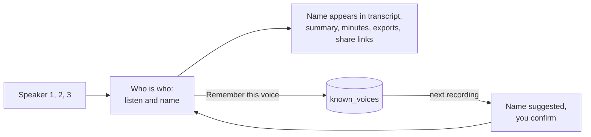

# Voices and speaker names

Phone recordings have no speaking indicator, so voices start as Speaker 1, Speaker 2 and so on. In the **Who is who** panel on the meeting page, listen to a few words of each voice and name it.

Giving two voices the same name merges them, which fixes one person split in two.

## Remembering voices

Off by default. Turn on **Remember voices of people I name** in Settings, Summaries, Recognise voices, to get name suggestions for voices heard before.

| Question            | Answer                                                                                             |
| ------------------- | -------------------------------------------------------------------------------------------------- |
| What is stored      | A voiceprint (numbers describing how a voice sounds), the name and the sample count. No audio.     |
| Where               | Your own database, table `known_voices`. Never sent to another service, never returned by the API. |
| What it is used for | Only to suggest a name next to a voice. You always confirm it.                                     |
| Which voices        | Only voices you name with Remember this voice ticked.                                              |

## Deleting

Delete one voice or all under Settings, Summaries, Recognise voices. Turning the setting off stops storing and suggestions.

> [!NOTE]
> Deleting a meeting removes its speakers' voiceprints from the meeting, not the remembered voices. Delete those separately.

## Privacy

> [!WARNING]
> A voiceprint can identify a person, so treat it as personal data. Tell people you record that their voice may be remembered, and delete voices on request. This is not legal advice. See the [consent and legal notes](consent-and-legal.md).
