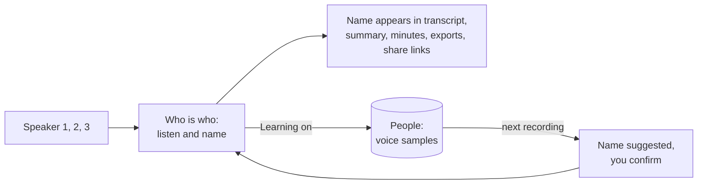

# Voices and speaker names

Phone recordings have no speaking indicator, so voices start as Speaker 1, Speaker 2 and so on. In the **Who is who** panel on the meeting page, listen to a few words of each voice and name it.

Giving two voices the same name merges them, which fixes one person split in two.

## People

Everyone you name, invite or add by hand is listed under **People**. A person has a name, none, one or several emails, and optional notes. People appear when you name a speaker, rename a participant or add one yourself. You can edit a person, merge two people and delete one. To merge, use **Merge into another person** on the person page, or tick two people in the list and choose **Merge 2 selected**. You pick which name to keep and the dialog lists what moves over (emails, voice samples, meetings, rename rules and invitations) before anything happens. The person you do not keep is removed. People who look like doubles, for example the same email, or "Dennis" and "Dennis Klappe" on the same company domain, show a **Possible duplicate** hint with a Merge button. Nobody is merged automatically. Renaming a person also renames their label in every meeting. The text of summaries and minutes is not rewritten.

Open a person to see:

- a **voice profile card per language**: one person, one name and one set of emails, but a separate profile for each language they speak, because most people sound different in Dutch than in English. Each card shows the language, the verified seconds against the target of 90 s, the sample count, a **Delete this profile** button and the verified lines in that language. A card appears by itself the first time a line in that language is verified, and up to 5 vectors (ways of sounding) are kept per language
- the **People list** shows a small chip per language next to the profile status
- **Needs review**: how many lines the review queue would ask about for this person, not every unsure line: the doubtful ones plus only as many confident lines as the voice profile still needs to reach its 90 seconds. Lines under 3 seconds, overlapped lines, filler and skipped lines never count. The same number shows in the People list (**To review**) and above the Review button
- **Verified lines**: lines you confirmed as this person

Each line can be played. **Verify** says the line is this person, sets the label as a correction of yours and, when learning is on, adds its voice to the profile. **Not this person** takes the line away and gives it to the next best speaker, and it is not offered to this person again. **Move to...** gives it to someone else. **Remove from profile** keeps the label but forgets the voice sample.

## Reviewing speakers

**Review** on the People page goes through a short queue of lines worth a look, all people mixed. The button shows how many it asks in one session (at most 25), as `25 of 140 lines` when more are waiting. Scope the same flow to one person (**Review** on their page) or one meeting (**Review speakers** in the meeting menu, also in the row menu of the meetings list). A chip shows the scope, its cross goes back to everyone.

A line enters the queue for one of two reasons, and the card says which:

- **Not sure who this is** (real doubt): the labelling is under 70% sure, the voice check disagrees, a close competing candidate scores 50% or more, the speaker review suggests someone else, or the line was labelled by elimination. This does not depend on how good the profile is, so a doubtful line of a well-profiled person is still reviewed.
- **Needs more samples** (training need): the label looks right, but the profile of that person in that language has less than 90 seconds of verified speech. Confirming the line adds to the profile. Once the profile is good enough these lines disappear, and the queue shrinks a lot.

Only lines that can teach a voice are asked: at least 3 seconds, nobody talking over them and not mostly filler ("yeah", "okay"). Within the queue, doubtful lines come first, then the people with the least verified speech, and the picks are spread over different meetings, moments far apart and sources instead of near duplicates. A session holds 25 cards. At the end, **Keep going** loads the next 25. The card shows a coverage meter such as "Dennis: 45 s of 90 s, Dutch", and the end screen lists the profiles that are good enough. The order switch (**Newest meetings first** or **Least sure first**) sorts the cards inside the session.

**Skip** is remembered: a skipped line does not come back after a refresh or in another session. It returns when you press **Review N skipped** at the end, or when the line is proposed for someone else. Approve, Disapprove and Skip are saved the moment you press them, and **Undo** takes the last one back on the server too (the old label, the voice sample and the skip).

Every card has its own address, `#/people/review/<line>` or `#/people/<person>/review/<line>`, with the scope and order in the address. A refresh opens the same card and the link can be bookmarked or shared. The address replaces the previous one as you move on, so Back leaves the review instead of walking through decided lines. If the line is no longer in the queue, a notice says so and the next card opens.

## Do not track

Choose **Do not track** on the person page, the People row menu or the review card for someone whose voice must never be kept. After you confirm:

- their voice samples, voice profile and the voice saved on their meeting participants are deleted
- no voice is learned for them, also not from lines you verify or move to them, and not from the **Not X, unsure who** answer
- they are not suggested anywhere: not as the proposed speaker on a review card, in the lists of other lines, in the speaker review, in the voice check, in name suggestions for unknown voices, or as a person created by the scan of your meetings
- their lines are never offered for review

They stay by name in transcripts and minutes. **Someone else...** in the review lists them as not tracked, and the People list can show them with the Tracking filter. **Track again** on their page undoes it, the voice then starts from nothing. Merging a person who is not tracked into someone keeps the result not tracked and without voice samples.

## Voice settings

Two options under Settings, Summaries, Voices. Both are off by default because a voiceprint is biometric data.

| Option                           | What it does                                                                                                                                                                                                                                 |
| -------------------------------- | -------------------------------------------------------------------------------------------------------------------------------------------------------------------------------------------------------------------------------------------- |
| Learn voices                     | Lines you name, assign or verify add a voice sample to the person, in the language of the line. Names you give in phone recordings are remembered, so the voice is suggested next time. Also allows [automatic samples](#automatic-samples). |
| Check lines against saved voices | Meet and Teams lines are compared with the saved voices of the people in the meeting and with the voices heard in that meeting. Lines that sound like someone else are flagged and show under People.                                        |

Without learning, verifying a line only confirms who said it. Without a saved voice nothing is checked and nothing changes.

| Question            | Answer                                                                                                                                           |
| ------------------- | ------------------------------------------------------------------------------------------------------------------------------------------------ |
| What is stored      | A list of numbers per verified line (a voice sample), the people and a profile of up to 5 vectors per language built from the samples. No audio. |
| Where               | Your own database, tables `people` and `voice_samples`. Never sent to another service, never returned by the API.                                |
| What it is used for | Suggesting a name next to a voice, and flagging lines that sound like someone else. You always decide.                                           |
| Matching            | A new voice is compared with every vector of a person and scores as the best of them, not as an average.                                         |

## The voice check

For meetings whose speakers come from the speaking indicator, when someone in the meeting has a saved voice or the meeting has clean lines of at least two people to learn from ([voices of this meeting](#voices-of-this-meeting)):

1. Each line is embedded on its own by the whisper service (`POST /embed-lines`). A line under half a second is read from a one second window around it.
2. The voice is compared with the saved voices of the meeting's participants.
3. A line is compared with the voice profile of its own language first. A person with no profile in that language is compared with their other languages, minus a small penalty (0.05). The timing score of the line is combined with how well its own voice fits against the best other voice. The voice can lower the confidence by half at the most. Its weight grows with the length of the line, reaching full at 2.5 seconds, because a voice print of a few words cannot tell people apart.
4. A line of at least a second is **doubted** when another saved voice fits clearly better than the labelled one, or the labelled voice fits very badly. A doubted line stays uncertain, gets the better fitting speaker as a suggestion and shows under People, Needs review.

The check scores the participants against each other, not against a fixed bar:

- a label that leads clearly (score of 70% or more and 30 points ahead of everyone else) gains a little confidence, never full certainty
- a saved voice that is sure of someone else (80% or more) while the line is labelled as another person is a conflict: the line is doubted, the label loses half of its candidate score and the better fitting speaker is suggested
- by elimination: when exactly one participant has no saved voice, nobody is marked do not track, and a line of 2.5 seconds or more fits none of the saved voices (all under 30%), the line is probably that participant. It gains confidence when already labelled so, else that participant is suggested. These lines are marked **By elimination**, always go to review, and are never added to a profile by themselves

### Voices of this meeting

The check also builds a temporary voice per participant from the meeting itself, so it works when nobody has a saved voice, and it can tell two unknown people apart. It uses the same option, **Check lines against saved voices**: with it off nothing is embedded and nothing is compared.

- **Anchor lines** are the cleanest lines of a participant: 3 seconds or more, labelled by the speaking indicator with at least 90% confidence, not changed by you or an AI review, no other line overlapping by more than 0.3 s, and the indicator showing only that person for at least 90% of the line. At most 12 per person, the longest first
- an anchor that does not sound like the person's other anchors (median cosine under 0.4, or under 0.5 to the rest) is dropped, so a label that lagged behind the indicator cannot poison the print. A person needs 2 anchors left to get a meeting voice. Without saved voices at least 2 people need one
- every line is compared with the meeting voices, an anchor line with the others so it does not vouch for itself. A person who also has a saved voice scores 60% saved voice and 40% meeting voice. The line then goes through the same judgement as above, so a line that sounds clearly like someone else is doubted and that person is suggested
- a line of 2.5 seconds or more whose label wins clearly (60% or more and 15 points ahead of the runner-up) is raised to 85% confidence, never to certainty. No label is changed by this check
- meeting voices exist only while the meeting is checked. They are not saved, not shown, and never added to a person's profile. Profiles still learn only from lines you verify and from the guarded [automatic samples](#automatic-samples), which only count the saved voices

The labels are never changed by the check. Lines you set yourself are skipped. The check runs when a meeting is transcribed, not when only the speaker check is rerun.

## Deleting

Delete the voice data of one person on their page, mark them Do not track to stop it for good, or delete everyone's under Settings, Summaries, Voices. People, names and emails stay. Turning an option off stops learning or checking and keeps what is saved.

> [!NOTE]
> Deleting a meeting removes its speakers' voiceprints from the meeting, not the saved voices. Delete those separately.

## Automatic samples

With **Learn voices** on, lines that are near certain are added to a profile without a review, with guardrails so a wrong guess cannot run away:

- only for tracked people, and only after the person has 30 seconds of speech verified by you in that language (an automatic sample never counts as a seed)
- the line must be 3 seconds or more with nobody talking over it, its label must come from the call's speaking indicator or diarization with at least 90% confidence, its voice score must be 80% or more and 25 points ahead of every other voice in the meeting. Lines set by you, changed by an AI review, doubted by the voice check or labelled by elimination never qualify
- automatic samples are stored as `auto`, counted apart on the profile card ("42 s verified, 3 min auto"), weigh 0.4 of a verified sample when the profile is built, may add up to 3 times the verified seconds and at most 60 seconds per person per meeting
- **Remove auto samples** on a profile card, or **Remove** per meeting in its list, deletes them and builds the profile again from the verified ones
- if you reject such a line it is removed, and that person needs 2 points more margin from then on (up to 15)

Automatic samples are never offered for review as a training need, and a line you confirm becomes a verified sample.

## Dutch and other languages

The speech model gives one language per recording (the language you chose for the meeting, or the one detected from the audio). Each transcript line stores that language as a two letter code in `transcript_segments.language`, taken from the provider per segment when it names one. The whisper service does not report a language per segment, so a meeting that switches between Dutch and English is tagged with one language today. Existing lines were tagged with the language of their meeting, and existing samples and profiles with that language, or `und` when it was not known. A voice sample stores the language of its line, so a profile is built per language: verifying a Dutch line teaches the Dutch profile only.

The default embedding model (3D-Speaker ERes2Net, trained on English VoxCeleb) works on Dutch speech but was not tuned for it. The model is read from the environment of the whisper service, so a multilingual model can be tried without a code change: set `DIARIZATION_EMBEDDING_NAME`, `DIARIZATION_EMBEDDING_URL` and `DIARIZATION_EMBEDDING_SHA256`. Voice prints of two models cannot be compared. After a change, delete the voice data and verify lines again. The model name is kept with every sample.

## Privacy

> [!WARNING]
> A voiceprint can identify a person, so treat it as personal data. Tell people you record that their voice may be remembered, and delete voices on request. This is not legal advice. See the [consent and legal notes](consent-and-legal.md).
